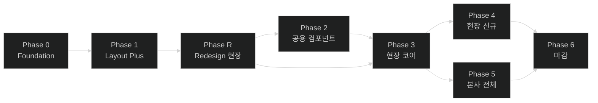

# 작업 로드맵 (roadmap.md)

> 본 문서는 [`screens.md`](./screens.md)의 화면 진행도(✓/△/✗)와 그동안 정리된 결정/Open Question을 종합한 **작업 순서**다.
>
> **원칙**
> - 화면보다 **인프라·공통**이 먼저 (Foundation 우선).
> - 위험도 A 화면은 안정된 공통 위에서 만든다.
> - 화면 작업은 현장(`/*`) → 본사(`/admin/*`) 순서 (1차 타겟 = 현장관리자).
>
> **항목 표기**
> - 위험도: A(치명적) / B(일반 CRUD) / C(정적)
> - 의존성: 이 항목을 시작하려면 끝나야 하는 선행 항목
> - 비고: 관련 문서/결정 링크

---

## 1. 우선순위 원칙

1. **인프라/공용**(Phase 0~2)이 화면 작업(Phase 3~5)에 선행한다.
2. **권한·인증 흐름**은 어떤 화면보다도 먼저 안정화한다.
3. **위험도 A 화면**(인증/권한/데이터 변형)은 토큰·가드·DTO가 확정된 뒤 시작한다.
4. 현장(`/*`)은 본사(`/admin/*`)보다 먼저. 명세서가 "여기에 가장 공들임"이라 명시.
5. **점진 마이그레이션 우선** (예: AppButton). 한 번에 전수 교체 금지(A3 최소 변경).

---

## 2. Phase 한눈에

| Phase | 테마 | 핵심 산출물 | 주 위험도 |
|---|---|---|---|
| **0** | Foundation | path 상수 / env / axios + `ApiResponse` 인터셉터 / 401 refresh / react-query / enum SSOT / `useQueryParams` / `<RequireRole>` / **sonner toast** / **MSW** / **AppFormField 분석·도입** | A |
| **1** | Layout Plus | AuthGuard 실제화 / 모바일 햄버거+Sheet / 본사 사이드바 config / TopNav 메뉴명 매핑 / ProfileBadge 메뉴 / 401·403·404 / AppTable 페이지네이션 / AppButton 마이그레이션 착수 | A·B |
| **R** | **Redesign (현장 사이트)** | **Pretendard + OKLCH 토큰 매핑 / `ServiceLayout` + 68px `RailSidebar` + 페이지 자연 스크롤 / 공용 컴포넌트(AppPageHeader · AppFilterButton · AppPagination · AppDetailCard · AppKpiCard · 결과 뱃지 5종) / 현장 5개 화면(순찰이력·코스/지점·근무자·배치관리·공지사항) UI 전면 교체** | **A·B** |
| **2** | 공용 컴포넌트 확충 | **AppSelect / AppDatePicker** (017에서 2종으로 재산정 — dnd-kit·첨부위젯은 수요 화면으로, 알림시트는 Phase 5로 이동. §6 참조) | B |
| **3** | 현장 코어 △→✓ | `/login` / `/zones` 디테일 / `/points` 디테일 / `/patrol/zones` 디테일 / `/patrol/points` 신규 / Export | A·B |
| **4** | 현장 신규 영역 ✗→✓ | `/users` / `/notice` / `/settings/keywords` / 🔴 **진행 중인 순찰 현황**(신규, 023 이 상태 컬럼을 뺀 근거) | B·C |
| **5** | 본사 영역 전체 | `/admin/login` / `/admin/locations`(+상세+헬스체크) / `/admin/admins`(+할당) | A |
| **6** | 마감 | 권한 매트릭스 검증 / 접근성 / 콘텐츠 톤 점검 / AppButton 마이그레이션 완료 / 성능 점검 / 정리 | — |

> **Phase R 삽입 사유**: 2026-07-23 리디자인 결정으로 현장 사이트 UI를 Notion/Linear/Vercel 계열로 전면 교체. 셸 자체가 바뀌므로 Phase 2/3의 화면 작업이 신규 셸 위에서 얹혀야 함. 데이터·기능·문구는 유지, UI만 교체. `/admin/*`(본사)은 이번 라운드 미적용 → Phase 5에서 별도 처리.

---

## 3. Phase 0 — Foundation (인프라)

화면이 의존하는 코어. 여기 늦으면 나중에 전수 수정 비용.

Phase 0은 spec 단위로 4개로 분할: **001-api-foundation** / **002-lint-cleanup** / **003-auth-foundation** / **004-dev-infrastructure**.
폴더는 Phase별로 묶는다: `specs/phase0/{001,002,003,004}-*/`. (번호는 Phase 무관 글로벌 일련번호)

| 항목 | 결과물 | 소속 spec | 의존성 | 비고 |
|---|---|---|---|---|
| axios 인스턴스 | `lib/axios.ts` | 001 | env | baseURL + 토큰 헤더 |
| **응답 인터셉터** | `ApiResponse<T>` unwrap + `code !== 200` throw | 001 | axios | `data-model.md` §2-1, §6 |
| react-query 셋업 | `QueryClientProvider` + 기본 옵션 + `select` 변환 규칙 | 001 | axios | DTO→ViewModel 변환은 select에서 |
| **sonner toast** | `<Toaster>` 마운트 + 기본 옵션 + 헬퍼(`toast.success`/`toast.error`) | 001 | — | `design-system.md` D6 |
| 사전 lint 정비 | 기존 lint 19건 해소 → `npm run verify` green | 002 | — | 001 이월. zone form / points·zones page / AuthGuard 등 본 spec 범위 밖이던 기존 에러 |
| **401 → refresh** | `/auth/refresh` 자동 호출 + 재시도 + 실패 시 영역별 로그인 이동 | 003 | 인터셉터 | `data-model.md` §4-3, `flow.md` §3-2 |
| 권한 가드 헬퍼 | `<RequireRole roles={[...]}>` | 003 | useMe 훅 | 화면 내 액션 권한 |
| `useMe()` 훅 | `MeDto` 상태 + 새로고침 시 `/auth/me` 동기화 | 003 | react-query | `data-model.md` §4-3 |
| 라우트 상수 SSOT | `src/router/paths.ts` | 004 | — | `screens.md` §4 라우트 매핑 |
| env 분기 | `VITE_API_BASE_URL` 등 | 004 | — | 테스트=IP / 운영=도메인+prefix (`data-model.md` §4) |
| Enum SSOT | `src/types/enum.ts` + 라벨 매핑 | 004 | — | `data-model.md` §2-2 |
| `useQueryParams` 헬퍼 | URL 쿼리스트링 표준 접근 | 004 | — | `patterns.md` §6 |
| **MSW 도입** | `src/mocks/handlers/*` + 개발용 worker 마운트 | 004 | react-query | 기존 `features/{도메인}/mock/*` 이관 |
| **vitest 셋업** | `vitest.config.ts` + `@testing-library/react` + `package.json` 스크립트(`test`, `test:watch`) | 004 | MSW | `workflow-protocol.md` WF-4 검증 인프라. 백엔드 연결 전엔 MSW 기반 단위/통합 테스트 |
| **AppFormField 분석·도입** | 폼 컨테이너 컴포넌트 + AppInput 폼 영역 정리 | 004 | — | `design-system.md` §6 Open Q 해소. Phase 3 폼 작업 전 필수 |
| Error Boundary (전역) | 페이지 단위 fallback | 004 | — | 안전망 |

**Phase 0 종료 조건(DoD)**
- 새 화면이 axios·react-query·toast·가드를 **표준 사용법대로** 호출할 수 있다.
- `npm run verify` 통과.
- `design-system.md` §6의 "AppFormField 도입 분석" Open Q 해소.

---

## 4. Phase 1 — Layout Plus (셸 확장)

화면 작업 가능한 최소 셸 완성.

| 항목 | 결과물 | 의존성 | 비고 |
|---|---|---|---|
| AuthGuard 실제화 | `isAuthentication = true` 제거 + 실 토큰 검사 + role 분기 | Phase 0 인증 셋업 | `flow.md` §0 |
| 모바일 햄버거 + Sidebar Sheet | TopNav 좌측 햄버거(`lg:hidden`) + 사이드바를 `ui/sheet`로 감쌈 | — | `layout.md` §5-6 |
| 본사 사이드바 config 분리 | `AdminMenus` export | — | `layout.md` §6 |
| TopNav 메뉴명 매핑 | 라우트 → 메뉴명 lookup | path 상수 | `layout.md` §6 |
| ProfileBadge 드롭다운 | 로그아웃 / 내 정보 | useMe | `layout.md` §6 |
| 401·403·404 화면 | 각 상태 페이지 컴포넌트 + 라우트 등록 | — | `screens.md` §3, `flow.md` §3-2 |
| AppTable 페이지네이션 UI | 페이지 번호·이전/다음·전체 표시 | Phase 0 page 1-based | `components.md` §9, `data-model.md` §2-1 |
| AppButton 마이그레이션 (착수) | 새 화면 = AppButton만. 기존 = 화면 작업 시 함께 교체 | — | `design-system.md` D1 |

**Phase 1 종료 조건**
- 모바일에서 사이드바 동작 확인.
- 새 화면이 페이지네이션 컴포넌트 그대로 사용 가능.
- 비인증 진입 시 라우트별 적절한 로그인 화면으로 리다이렉트 검증.

---

## 5. Phase R — Redesign (현장 사이트 UI 전면 교체)

> **배경**: 2026-07-23 결정. 1차 시안이 "장난감 같다"는 피드백 → Notion / Linear / Vercel 계열 미니멀·고밀도 SaaS 스타일로 전환. 데이터·기능·문구는 유지, UI만 교체.
> **범위**: 현장 사이트(`/*`) 전체 셸 + 5개 화면(순찰이력·코스/지점·근무자·배치관리·공지사항).
> **범위 밖**: `/admin/*` 본사 사이트, 로그인/랜딩 → Phase 5에서 별도 처리.
> **입력 문서**: [`docs/new-design-note.md`](./new-design-note.md), [`docs/ui-mock/현장/**/*-신규.png`](./ui-mock/), [`docs/design-system.md`](./design-system.md) D10, [`docs/layout.md`](./layout.md) §0·§2, [`docs/screens.md`](./screens.md) §1-2~§1-5.

### 5-1. 페이즈 구조 (R0 → R1 → R2 → R3)

| 단계 | 성격 | Spec | 병렬 가능? |
|---|---|---|:-:|
| **R0** | 기반 (블로킹) | 007 (단일 통합) | X (선행 필수) |
| **R1** | 공용 컴포넌트 | 008 (단일 통합) | R0 완료 후 시작 |
| **R2** | 화면별 리디자인 | 009 ~ 015 (7개 spec) | R1 완료 후, 화면 간 병렬 가능 |
| **R3** | 회귀 확인 | 016 | R2 전체 완료 후 |

### 5-2. Spec 인벤토리

| Spec ID | 폴더 | 성격 | 위험도 | 라우트 | 비고 |
|---|---|---|:-:|---|---|
| **007** | `specs/phaseR/007-redesign-foundation/` | R0. Pretendard 폰트 + OKLCH 토큰 매핑 + `--rail`/`--rail-2` 신설 + **라우터 레벨 `ServiceLayout`/`AdminLayout` 분리** + 68px `RailSidebar` 신규 + 페이지 자연 스크롤 정책 전환 | **A** | (셸) | 이후 모든 화면의 전제 조건 |
| **008** | `specs/phaseR/008-redesign-shared-components/` | R1. `AppPageHeader` / `AppFilterButton` / `AppPagination`(리뉴얼) / `AppDetailCard` / `AppKpiCard` / 결과 뱃지 5종 variant 추가 | B | (컴포넌트) | R2에서 재사용 |
| **009** | `specs/phaseR/009-patrol-history-zone/` | R2-1. 순찰이력 코스 탭 리디자인 | B | `/patrol/zones` | 마스터-디테일 카드화, 특이사항 자동펼침 |
| **010** | `specs/phaseR/010-patrol-history-point/` | R2-2. 순찰이력 지점 탭 (신설) + 기록 상세 모달 | B | `/patrol/points` | screens.md §1-2 진행도 ✗ → ✓ |
| **011** | `specs/phaseR/011-course-management/` | R2-3. 코스 탭 + 경로 다이어그램 카드 신규 | B | `/zones` | zigzag 다이어그램, 4개마다 줄바꿈, 좁은 폭 숨김 |
| **012** | `specs/phaseR/012-point-management/` | R2-4. 지점 탭 (편집 모달 유지) | B | `/points` | 상세 카드 확장 |
| **013** | `specs/phaseR/013-workers/` | R2-5. 근무자 관리 (신규 라우트) | B | `/users` | 배치변경 버튼 제거, 메뉴명 "근무자" |
| **014** | `specs/phaseR/014-deployments/` | R2-6. 배치관리 대시보드 (신규 라우트, 신규 워크플로) | **A** | `/deployments` | KPI + 인라인 승인/거부 + 거부 사유 모달 + 이력 탭 |
| **015** | `specs/phaseR/015-notice/` | R2-7. 공지사항 (다른 화면과 동일 컨셉 자동 적용) | B | `/notice` | 별도 목업 요청 없음 |
| **016** | `specs/phaseR/016-redesign-regression/` | R3. 본사 사이트 미영향 + 로그인/랜딩 미영향 + 접근성/콘텐츠 톤 회귀 | C | (전역) | 리디자인 마감 |

### 5-3. Phase R 종료 조건 (DoD)

- 현장 사이트 5개 화면이 모두 신규 셸(`ServiceLayout` + `RailSidebar`)에서 렌더링되고 `docs/ui-mock/현장/**/*-신규.png`와 시각적으로 일치.
- `/admin/*` 본사 사이트는 기존 셸(`AdminLayout` + `Sidebar` w-70 + `TopNav`)로 그대로 동작 (리디자인 미적용).
- 로그인/랜딩 페이지 미영향.
- `npm run verify` + `npm run test` green.
- `screens.md` §1-2~§1-5의 진행도 컬럼과 §4 라우트 매핑이 리디자인 완료 상태로 동기화.

### 5-4. Phase R 이후 (Phase 2~4)

- 원래 Phase 2 (공용 컴포넌트 확충)는 리디자인 이후에도 여전히 필요 (`AppSelect`/`AppDatePicker`/dnd-kit Provider 등은 리디자인 범위 밖).
- Phase 3/4의 화면 작업은 이제 **리디자인된 셸 위에서** 진행. 화면별 진행도 △/✗을 ✓로 마감하는 작업은 그대로 유효하되, 리디자인 결정에 맞춰 세부 스펙 재확인 필요.

---

## 6. Phase 2 — 공용 컴포넌트 확충

> **2026-09-29 재산정(017)**: 원안은 5개 항목을 "Phase 3에서 막히지 않도록 미리" 묶어둔 것이었다. Phase R 완료 후 코드에서 소비처를 실제로 세어 보니 **수요가 복수 화면에 걸친 것은 2종뿐**이었다. 나머지는 단일 화면에 국한되거나(1곳) 현장에서 소멸(0곳)해, 미리 만들면 A3(최소 변경)·A6(미래 확장 포인트 금지)에 어긋난다. 따라서 Phase 2를 2종으로 좁히고 나머지는 이동한다.

### 6-1. Phase 2 범위 (017)

| 항목 | 결과물 | 확정 수요 | 소속 spec |
|---|---|---|---|
| `AppSelect` | 단일 선택 드롭다운 | **9곳** — 필터 8(`/patrol/zones` 2·`/patrol/points` 4·`/users` 2) + `AppPagination` 행수 1 | 017 |
| `AppDatePicker` | 날짜 **범위** 선택 | **2곳** — `/patrol/zones`·`/patrol/points` 기간 선택 | 017 |

- `AppSelect` 다중 선택, `AppDatePicker` 단일 날짜는 **확정 수요 0곳이라 미구현**. 필요해질 때 확장(기존 호출부 무변경).

### 6-2. 원안에서 이동한 항목

| 항목 | 확정 수요 | 이동 위치 | 사유 |
|---|---|---|---|
| dnd-kit Provider | 1곳 (`/zones` 지점 드래그 정렬) | 해당 화면 실동작 작업 시 | 단일 화면용 추상을 미리 만들 이유 없음 |
| Notice 첨부 업로드 위젯 | 1곳 (`/notice`) | 해당 화면 첨부 실동작 작업 시 | 상동 |
| 알림 시트 본문 | **0곳 (현장)** | **Phase 5 (본사)** | `AlarmSheet`는 `TopNav.tsx`에 있고 007에서 `TopNav`가 `AdminLayout` 전용이 됨. 현장 코드에 참조 0건 — 애초에 현장 공용 컴포넌트가 아니었음 |

**Phase 2 종료 조건**
- 순찰이력·근무자 화면의 필터 팝오버를 조립할 수 있는 선택 계열 primitive가 갖춰진다(018에서 실제 조립).

---

## 7. Phase 3 — 현장 코어 화면 마감 (△ → ✓)

screens.md 진행도 △ 일괄 마무리. 위험도 A 우선.

| 항목 | 라우트 | 위험도 | 상태 | 비고 |
|---|---|:-:|:-:|---|
| 로그인 실구현 | `/login` | A | ☑ | **020 완료.** zod 검증 + `code` 기반 사이트 분기 + 근무자 차단. `/admin/login`도 같은 폼으로 함께 구현 |
| 코스 추가/수정/삭제 | `/zones` 모달 | A | △ | 폼 + 확인 모달 |
| 코스 내 지점 드래그 정렬 | `/zones` | A | △ | dnd-kit + `ReorderCoursePointsRequest` |
| 코스 내 지점 시간/활성 모달 | `/zones` 모달 | A | △ | `UpdateCoursePointRequest` |
| 지점 추가/수정 | `/points` 모달 | A | ☑ | **022 완료.** NFC HEX 14자리 검증(zod) + 실 API(POST/PATCH). 편집은 모달 유지 |
| 지점 QR 다운로드 | `/points` 액션 | A | △ | 파일 다운로드 |
| 지점 삭제 | `/points` 액션 | A | ☑ | **022 완료.** 프론트 선제 차단 없이 호출하고 서버 거부 사유를 노출. ⚠️ `usedCount > 0` 거부 여부는 **미실측**(OQ-022-B) — 확인은 코스 편성 API(023) 이후 |
| 코스 이력 필터·상세 | `/patrol/zones` | B | △ | URL 쿼리스트링 / 타임라인 / `useQueryParams` |
| 지점 이력 + 기록 상세 | `/patrol/points` | B | ✗ | 신규. 모달 상세 포함 |
| 이력 Export | 액션 | B | ✗ | Excel / PDF. 두 이력 공용 |

**Phase 3 종료 조건**
- screens.md 1-2/1-3의 진행도가 모두 ✓.
- 실 API 또는 MSW로 동작 확인.

### 7-1. 실 API 전환 spec 번호 (확정 2026-10-06 — **번호의 SSOT**)

> 019를 "통신 계약"으로 좁히면서 뒤 번호가 한 칸씩 밀렸는데 본 문서가 갱신되지 않아
> 같은 번호가 세 군데에서 다른 것을 가리켰다(§13 MSW 항목 = 020:순찰지점 / §12 018 행 =
> 022:지점이력 / `019/spec.md` = 022:순찰지점). **`019/spec.md`의 체계로 통일한다** —
> 019가 이미 `spec 021`(사업장 선택)·`022`(순찰지점 CRUD)·`024`·`025`를 본문에서
> 참조하고 있어 그쪽이 다수이자 선행이다. 앞으로 번호는 **이 표가 SSOT**다.

> 🔴 **번호 폐기 — `024`·`025` 는 쓰지 않는다 (사용자 결정 2026-10-16).**
> 리디자인 목업 4종(`docs/ui-mock/현장/순찰이력/0{1..4}-*.html`)과 2026-10-16 실측으로
> **범위가 전면 재정의**돼 옛 계획을 이어 쓸 수 없게 됐다. 그래서 내용을 새로 쓰되
> **번호는 재사용하지 않는다** — 이 표가 가리키는 대상이 조용히 바뀌면 2026-10-06 사고
> (위 문단)가 그대로 반복된다. 024·025 를 참조하는 문서가 **14곳**이기 때문이다.
>
> | 옛 번호 | 새 번호 |
> |---|---|
> | `spec 024`(지점 순찰이력) | **`spec 037`** |
> | `spec 025`(코스 순찰이력) | **`spec 036`** |
> | 024·025 공용이던 것(뱃지·enum·필터·카드 골격·페이지네이션) | **`spec 036`** (공용 기반을 036 이 세우고 037 이 쓴다) |
>
> **다른 문서에서 `spec 024`·`025` 를 보면 이 표로 와서 읽는다.** 종료된 spec 안의 이월
> 기록(`019`·`022`·`023`·`027`·`028`·`030`·`032`·`034`)은 **그 시점의 사실**이라 고치지
> 않는다(A3) — 역사 서술을 덮으면 왜 그렇게 결정했는지가 사라진다. 아직 살아 있는 작업
> 지시(`patterns.md` 대기 목록 · `screens.md` 미해소 항목 · 본 문서 §13)만 새 번호로 고쳤다.
>
> **036·037 이 받는 이월 (14곳)**
>
> | 이월 출처 | 내용 | 수령 |
> |---|---|:-:|
> | `019/spec.md:14` | 018 T158·T160·T161 — 지점이력 필터 옵션·UI 배선·화면 테스트 | 037 |
> | `019/spec.md:15` | 018 T162·T163 — 페이지네이션 URL 이관 | 036·037 |
> | `019/spec.md:16` | 018 T169 — M2 시각 검증 | 036·037 |
> | `019/spec.md:17` | 018 산출물 `filterCourseHistory.ts` 정리 | 036 |
> | `019/spec.md:18` · §13 | **결과 뱃지 ↔ 서버 `status` 불일치 + enum SSOT 3중 분기**(`PointResult` 소비처 0개 · feature types dead) | 036 |
> | `023/tasks.md:371·842` | 이상 이력의 **사유**(메모 내용 표시) | 036 |
> | `034/spec.md:135` OQ-034-A | 이력 2화면 **카드 골격** 적용 | 036·037 |
> | `030/tasks.md:140` | `ZoneHistoryCard`·`PointHistoryCard` mock → 서버 매핑 | 036·037 |
> | `022` OQ-022-H · `023` DoD #15 | 구 `PointType`·`PointAuthenticationMethod` 소멸 자리 | 036·037 |
> | `027/tasks.md:288` | `AppDatePicker` 단일선택 → **기간 선택** 확장 | 036 |
> | `patterns.md:539·545` | `/patrol/points` 필터 · 대기 중 5종 | 037 |
> | `screens.md:54` | 코스 이력 서버 필터 전환 · Export | 036 |
> | `screens.md:55` | 지점 이력 필터 5종 · Export | 037 |
> | `screens.md:63` | §13 Open Q 확정 | 036 |

| spec | 범위 | 상태 | 번호 근거 |
|---|---|:-:|---|
| **019** | api-contract — 통신 계약(응답 unwrap·에러 정규화·토큰 재발급) | ☑ | — |
| **020** | **실 로그인 + JWT 전환** — 로그인 폼·`code` 라우팅·근무자(`202`) 차단·`useMe`를 JWT 디코딩으로 교체·MSW `me` 핸들러 및 `DEV_ROLE_KEY` 제거 | ☑ | `019/spec.md:75·82·146`, `019/tasks.md` 이월 블록 |
| **021** | **사업장 선택 — 현장만** — `UserSiteSelect`·0/1/N 분기·`siteSeq` 저장·`AuthGuard` 미선택 차단. 본사(`AdminSiteSelect`)는 Phase 5로 이동 | ☑ | `019/spec.md:89` "접근 가능 사업장 제한은 `spec 021` 책임" |
| **022** | 순찰지점 — **변경계(POST/**PATCH**/DELETE) 첫 적용**. OQ-E 실측 지점 | **◩** | `019/spec.md` OQ-E · 🔴 **`PUT` 아니라 `PATCH`**(swagger 실측, 022에서 교정) |
| **027** | **순찰지점 화면 재구성** — 좌/우 마스터-디테일 → **목록 페이지 + 상세 페이지**(라우트 분리). 필터·검색·페이지 이동을 **새 구조 안에서** 수행(022 US5 이월) | ☑ | 사용자 결정 2026-10-08. ⚠️ **번호는 맨 뒤를 쓴다** — `023~026` 이 여러 문서에서 이미 참조돼 밀면 2026-10-06 재정렬 사고가 반복된다. 🔴 **실행 순서는 `022 → 027 → 023`** 이고 번호 순서와 다르다 |
| **023** | 순찰코스 | ☑ | ⚠️ 추론 — 019에 명시 참조 없음. §13 전환 순서(지점→코스)와 전후 번호로 역산 🔴 **착수 전 WF-1-0 필수**(`workflow-protocol.md` §1) — `AddCourse`·`UpdateCourse`·`DeleteCourse` 실측. ⚠️ **`UpdateCourse` 는 `PUT`** 이라 PATCH 인 지점과 부분 갱신 동작이 다를 수 있다 ✅ **WF-1-0 완료(2026-10-10)** — 변경계 3종 실측. 🔴 **범위 확정: API 전환 + 화면 재구성(A구조)** — 지점을 012→022→027 로 두 번 갈아엎었으므로 코스는 한 번에 한다 ✅ **WF-1·WF-2 완료(2026-10-11)** — 7 Phase · T341~T379. 🔴 **Phase 4의 백엔드 대기가 사라졌다** — 실측 후 설계가 결함 3건(B-25·B-27·B-28)을 전부 흡수했다. ✅ **Phase 1~4 완료(2026-10-12)** — 목록·상세 전환 + CRUD·토글 2종 확인 모달·지점 편성(드래그 정렬). `dnd-kit` 3패키지 **도입 완료**. 🔴 실측으로 결함 3건 추가 등재(B-29·B-30·B-31) — `totalMin` 은 **항상 `null`** 로 보내 서버가 구간시간 합으로 계산하게 했다. ✅ **Phase 1~4 사용자 브라우저 확인 완료(2026-10-12, 38항목)** — 결함 1건(mock 이 새 편성 행에 **같은 `coursePointSeq`** 를 줘 "하나 지우면 둘이 지워짐"), **틀린 문구 1건**(OQ-023-F 해소 — 코스는 **배정이 아니라 근무자가 직접 고른다**), 설계 변경 3건(목록 **상태 컬럼 제거 → 6컬럼**으로 ✅ **OQ-3·OQ-023-B 종결** · 교대 `-`→뱃지 · 못 찾은 상세에 복귀 링크). ✅ **OQ-027-D 방향 확정 — 카드형 목록.** ✅ **코스 상세 UI 재설계 A단 완료(2026-10-12)** — 목업 `코스상세-신규.html` 기준 2열 골격 전환 + 헤더 요약 뱃지·편성 편집 승격 + 기본정보 효과 한 줄. 🔴 **대조 중 앞선 판정 2건이 틀린 것을 발견했다**: 좌표는 서버에 **있고**(`PointDetail.gpsLat/gpsLng`) 없는 것은 `GetCourseDetail.points[]` 뿐이며(→ **B-32** 등재), 코스 기준 이력도 **있다**(`GetCourseHistory` 가 `courseSeq` 를 받는다). 그래서 지도·순찰기록·KPI 가 B~D단으로 사정권에 들어왔다 — ⚠️ B·C 는 **`spec 025`(코스이력) 과 분담을 정한 뒤** 착수한다. ✅ **B단 완료(2026-10-12)** — 최근 순찰 기록 표 + KPI 4종(`GetCourseHistory`·`GetPointHistory` 각 1요청, **백엔드 요청 0건**). 집계는 **프론트에서 30일 고정**으로 더한다(6개월·1년이 필요해지면 그때 집계 API 요청). 🔴 실측 예외 4건을 설계에 박았다(근무자 없는 이력 · **완료인데 인증 0** · 소요시간 **시 단위** · 읽을 수 없는 소요시간). 🔴 지점 상태의 **`순찰제외`** 때문에 인증률에 **색을 입히지 않는다.** ⚠️ **사고**: `GetPointHistory` 핸들러를 두 번 선언해 MSW 가 앞의 것만 써 조용히 0건이 왔다 — 중복을 지우고 기존 핸들러를 확장했다(제약 7 과 같은 종류). ✅ **C단 완료(2026-10-12)** — 미인증·이상 이력 카드를 **사유 없이**(요청 0건, B단 두 응답에서 모음). 🔴 메모 실측으로 **OQ-13·OQ-14 해소**(`imagePath` 는 절대 URL / `memoList` 는 `memos` 와 **구조가 다르다** → **B-35** 등재)했지만, 사유는 **목록에 없어 행마다 상세 조회(N+1)**이고 내용이 `"[조명 고장] [누수]"` 류 **키워드 조합**이라 "이상 사유" 가 아니다 — `메모` 뱃지만 두고 내용은 `spec 025` 이력 상세로 넘겼다. ✅ **Phase 5 완료(2026-10-13)** — 027 이월 + 셸 승격 판단, **백엔드 요청 0건**. 🔴 **계획 두 건의 전제가 틀려 있었다**(계획이 Phase 1~4 이전에 쓰임): **T370** 구 `PointType` 은 **지울 수 없다**(`mock/pointData.ts` 가 MSW dev 데이터 출처) — 남은 외부 참조는 1곳뿐이고 그것도 `spec 024`·`025` 전환 때 소멸하므로 **하지 않고 주석을 정정**(DoD #15 미충족 + 사유). **T374** `patterns.md` **§5 에 존재하지 않는 API**(`ReorderCoursePointsRequest`·`orderedPointIds`)가 적혀 있었다 — 실제는 `UpdateCourse` 전량 전송 + 편집 모드다. §10 은 **(A) 즉시 반영 / (B) 확인 모달** 두 갈래로 분기하고 `design-system.md` **D8 도 함께 정정**. **T371** 의미 없던 코스 활성여부 점을 **채우지 않고 제거** — 채우려면 지점 상세마다 코스 목록 조회(+페이징)가 붙는다. **T372** 대신 소속 코스 → `/zones/:courseSeq` **링크**. 027의 비활성 `코스에 추가` 버튼은 (`"준비 중"` 안내가 023 때문에 **거짓이 됐다**) **제거**했다 — 여기서 바로 편성해 주지 못하는 이상(요청 3개) 버튼은 "다른 데 가서 하세요" 만 말하는 **자리 차지**다. 직접 편성은 별도 작업. **T373** 라벨+값 행 **3곳을 `AppDetailRow` `variant` 로 통합**(`points/DetailRow` 삭제), 🔴 **카드 셸 7곳은 뽑지 않는다**(머리 구성이 제각각이라 prop 6개짜리 추상화가 된다 — 뽑지 않는 것도 결론, DoD #17). 테스트 **731 → 732**. ✅ **사용자 브라우저 확인 완료(2026-10-13, 20항목)** — 전 항목 통과, 변경 요청 2건 반영(편성 버튼 제거 · 빈 상태 문구 축약). 🔴 **회귀 6항목 전부 통과**가 T373의 근거다(행 3곳을 공용으로 합쳤는데 겉모습이 하나도 안 바뀌었다). ✅ **Phase 6 완료 → `spec 023` 종료(2026-10-13)**. **DoD 19/21 충족 · 1건 부분(#16) · 1건 미충족(#15)** — 두 건 모두 **조건이 쓰인 시점의 전제가 틀렸던 경우**라 억지로 맞추는 대신 사유를 남겼다. T375 로딩 3종: 목록은 이미 고정돼 있었고 **상세·변경을 테스트로 채웠다** — 🔴 상세가 더 위험한 자리다(빈 상태가 "삭제되었거나 접근할 수 없는 코스입니다" 라고 **단정**해서, 조회 중에 뜨면 방금 지운 줄 안다). T376 캡쳐 **1장 → 2장**(`zones--목록`·`zones--상세`) + `points--상세` 재촬영, 🔴 **나머지 9장은 덮지 않았다**(±1% 는 Chromium 노이즈 — 다시 커밋하면 진짜 변경이 묻힌다). `CAPTURE_OUT` 환경변수를 추가해 "덮어쓰기 전에 먼저 찍는다" 규칙을 코드가 지원하게 했다. T377 브라우저 확인 **누적 58항목**. T378 문서 7건 동기화(`screens.md` §1-3·§4 / `flow.md` §1-1·§1-2 / **`data-model.md` §8-4 신설** — 규약은 안 바꾸고 이력 루트 분리·기간 포함·`useMemo` 함정만 추가). ✅ **OQ-023-A·C·D 종결** — 023 의 Open Question 6건이 **전부 닫혔다**. 남은 것은 **D단**(지도 — B-32·B-33 + **지도 공급자 결정 미정**)·C단 사유(→ `spec 025`)·지점 상세 직접 편성(요청 3개, 별도 작업) |
| ~~**024**~~ | ❌ **번호 폐기(사용자 결정 2026-10-16).** 지점 순찰이력 — 018 필터 이월분·뱃지 정리 | ✗ | 아래 **"번호 폐기"** 블록 |
| ~~**025**~~ | ❌ **번호 폐기(사용자 결정 2026-10-16).** 코스 순찰이력 — 018 산출물 정리·페이지네이션 이관 | ✗ | 아래 **"번호 폐기"** 블록 |
| **026** | **공지사항** — 목록 테이블화 + 상세 재구성 + **조회만** 서버 전환 | ☑ **종료(2026-10-20) · DoD 19/20 + 부분 1** | 사용자 결정 2026-10-20: 목업 없이 **기존 리디자인 화면과의 통일**이 기준. 🔴 **작성·수정·삭제는 UI 만(mock)** — 첨부 업로드(multipart)·OQ-12 를 함께 풀어야 해 **변경계 전환 spec 으로 분리**. 실측으로 `keyword` = **제목 + 본문**(작성자 ✗) · 고정 공지 **서버 정렬** · 기간 `createDt` 양 끝 포함 확정(`api-spec.md` §23) |
| **028** | **코스 지점추가 모달 재구성** — 인증수단 칩·검색 하이라이트·선택 순서 목록·추가 후 순번 | ☑ | 사용자 결정 2026-10-13. ⚠️ **번호는 맨 뒤를 쓴다**(027 선례). 🔴 **백엔드 요청 0건**. 실측으로 **B-29 철회**(코스에서 지점 사용여부를 바꾸는 개념이 없다) + **B-36 신설**(`points[].useYn` 이 항상 `true`) + `GetClassificationPoint` 가 **미사용 지점을 제외한다**는 사실 확인 — 이전 주석 11곳이 반대로 적혀 있었다 |
| **029** | 지점 상세 디테일 | ☑ | 사용자 결정 2026-10-13. ✅ **WF-1-0 실측이 설계를 바꿨다** — `authMethod: 10` 은 `nfcTagId` 없이 보내면 **400** 이라 **전환이 방향에 따라 비대칭**이 된다(NFC→QR 확인 모달 / QR→NFC **입력 모달**). 🔴 **B-37 신설**(`reissueQrYn` 이 200 을 주면서 아무것도 바꾸지 않는다) → 재발행 버튼을 **만들 수 없다**. 🔴 **B-39 신설**(`nfcTagId` 중복이 **500** — 삭제한 지점이 태그를 계속 점유한다). 🔴 **B-19 철회**(그 4칸을 화면에서 치웠다 — 받을 자리를 없애 놓고 요청만 남기지 않는다). ✅ **QR 은 내려받기 전용**(브라우저 확인 중 변경) — 화면에 띄우면 **찍어서 현장 밖에서 인증**할 수 있다. 식별자 문자열도 같은 이유로 숨긴다. ✅ 2열 재구성 — 좌 2/3 소속 코스·순찰 기록 / 우 1/3 기본정보·자격증명, 좁은 폭에서는 `order` 로 기본정보를 앞세운다. **화면에서 placeholder 가 전부 사라졌다**(OQ-027-E 종결). vitest **756 → 772** |
| **030** | 목록 반응형 카드 — `AppTable` **opt-in** 카드 모드 + 4화면 | ☑ | 🔴 **프로젝트의 첫 반응형 분기**(`xl:hidden` 을 쓰는 파일이 0건이었다) → `patterns.md` **§14 신설**. ⚠️ 소비처는 7곳이 아니라 **6곳**이었다(`CoursePatrolLog` 은 주석에서 언급만 — grep 이 문장을 셌다). 비대상 2곳(`/users`·`DeploymentHistoryTabs`)은 **무변화**. ✅ **PC 폭 14장 ±0%** 로 확인(`zones--목록`·`patrol-points--목록` 은 바이트 동일). **OQ-030-A**(`/users` 제외 — 주범이 400px 패널이라 카드만 붙이면 들어갈 폭이 없다)·**OQ-030-B**(좁은 폭 캡쳐 안 남김) 모두 종결 |
| **031** | KPI 공용 카드 재설계 — `PointStats` 흡수 | ☑ | ⚠️ **배치관리까지 3화면**이 함께 바뀐다. 🔴 **착수 판단이 뒤집혔다**: 처음엔 "바 1칸·증감 0칸" 이었는데, 목업 수정안이 **외부 비교(전월 대비) 대신 응답 안의 구성(분모)** 을 쓰는 길을 제시했다 — **요청 0건으로 8칸 중 6칸**이 채워졌다. 🔴 **확장 전에 결함 2건을 먼저 고쳤다**(분모를 붙이려고 데이터를 보다 발견): **`pageSize` 상한 초과**(100 인데 200 전송 → 지점 상세 순찰 기록이 **실서버에서 통째로 400**, 화면엔 "기록 없음") · **미완료를 인증으로 셈**(69건 중 미완료 43건, **미완료도 `checkDt` 를 갖는다**). 🔴 **시각은 색이 아니라 위치로 풀었다** — 아이콘을 제목 줄 **왼쪽**으로(목업은 우상단). "여백이 많다" 의 원인이 배치였다. 색은 **바가 전담**한다 |
| **034** | **목록 카드 시각 정합** — 목업 A안(아이콘 타일형) | ☑ | 사용자 결정 2026-10-14. 🔴 **031 과 032 사이**에 둔다 — 030 은 구조만 세우고 시각은 손대지 않았고, 031 이 카드 어휘를 새로 정하므로 그 전에 다듬으면 두 번 만진다. ⚠️ 이력 2벌은 `024`·`025` 에서 어차피 다시 열리므로 **코스/지점 2벌만** 맞추고, 이력은 서버 전환 때 같은 기준을 적용한다(세 번 만지지 않는다) |
| **036** | **코스 순찰이력** — 공용 기반(결과 뱃지 · enum SSOT 일원화 · 필터 바 · `AppDatePicker` 기간 확장) + 코스 이력 목록 + 코스 순찰 상세(인증 내역 · 지도 · KPI) | ☑ **종료(2026-10-19) · DoD 18/18** | **024·025 를 대체한다**(사용자 결정 2026-10-16). 🔴 **코스를 먼저 하는 이유 3개**: ① **뱃지 전량이 코스 쪽에서만 관측된다** — `CheckDetails` 에 `0 대기중`·`1 진행중`·`3 미완료`(방문/무방문)·`4 완료` 가 다 나오고 지점이력은 **부분집합 `3`·`4` 뿐**이다(`api-spec.md` §4 실측 분포). 지점을 먼저 하면 2종만 보고 만든 뱃지를 코스에서 다시 넓힌다 — 018 이 5종을 2종 위에 설계했다가 막힌 것과 같은 실수 ② **037 은 `historySeq` 백엔드 회신에 묶여 있고 036 은 안 묶여 있다** — 035 반영 대기 중에도 진행된다 ③ 018 이월 `filterCourseHistory.ts` 정리가 코스 쪽이라 공용 필터를 세우며 함께 해소된다. ⚠️ **사진은 빈 칸으로 만든다**(B-40 — 첨부 URL 이 404). onError 폴백 + 회신 후 재확인 |
| **037** | **지점 순찰이력** — 지점 이력 목록 + 지점 인증 상세 | ☑ **종료(2026-10-20) · DoD 17/18 + 부분 1** | **024·025 를 대체한다.** 🔴 **선행: `historySeq` 백엔드 회신** — 지점 인증 상세의 KPI 2종(직전 지점 간격·코스 내 순서)·코스 내 위치 타임라인·"코스 순찰 상세" 링크가 **전부** 회차 식별자에 걸려 있다(`PointHistoryDetail` 에 `courseSeq` 만 있고 `historySeq` 가 없다). 받으면 네 개가 **한 번에** 열린다(`CheckDetails` 1회로 계산). 회신이 늦으면 목록만 선출고하고 상세를 분리한다 |
| **038** | **근무자** — 목록 + 상세 페이지 재구성 + **조회 서버 타입 전환** | ☑ **종료(2026-10-21) · DoD 20/21 + 부분 1** | Phase 4. 번호는 **맨 뒤**(예약 없음, 027 선례). 🔴 **현장관리자는 `UserList`·`UserDetail` 이 403** — 서버 타입·MSW 위에서 만들고 권한 개방을 요청했다(**B-41**, 사용자 결정 2026-10-21). 실측으로 `searchKey` = **이름 + 사번** · `originSiteSeq` = **배치 온 사람의 소속지**(OQ-7 해소) 확정 |
| **039** | **배치관리** — API 없이 **프론트가 먼저**(가정 계약 + 상태 보유 MSW) · 백엔드 요청서 | ☑ **종료(2026-10-21) · DoD 19/20 + 부분 1** | Phase 4. 🔴 **배치 API 0종**(실서버 swagger 44종 재대조) → 사용자 결정: 백엔드는 화면이 나오면 만들 계획이었다 — **프론트가 화면을 먼저 만들고 요청한다**(`docs/api-request-deployment.md`, "API — 한 줄 설명" 목록). 화면은 사용자 확인을 거치며 **KPI(한 줄) + 탭 3개 + 표 1개**로 재구성. ⚠️ 백엔드 구현 후 WF-1-0 으로 가정 계약 교정 |
| **040** | **공지 쓰기** — 작성·수정·삭제 + 첨부 서버 전환(**첫 multipart**) | ☑ **종료(2026-10-21) · DoD 15/15** | Phase 3, 026 이월 ①. WF-1-0 실측(공지 3종 · OQ-12 해소 · B-42 앱 푸시 · B-43 첨부 형식 · OQ-19 한도). 사용자 결정: 앱 푸시 체크박스 제거 · 상단 고정 기본 해제 · 첨부 제한은 실측값. dev:real 화면 확인 ✅(026 T592 함께) |
| **041** | **근무자 쓰기** — 추가·정보 수정·비밀번호 변경·삭제 서버 전환 | ☑ **종료(2026-10-21) · DoD 13/14 + 생략 1** | Phase 4, 038 이월 ②. WF-1-0 실측(근무자 3종 · B-44 `codeSeq` 누락 500 · B-45 서버 입력 검증 없음). 사용자 결정: 비밀번호는 새 값 지정 + 별도 버튼 · 권한 근무자 고정 · 사진 제외. 후속: 상세 좌우 교체 · 액션을 기본정보 카드 아래로. ⚠️ 캡쳐는 생략(사용자 결정) · dev:real 확인 ✅ · 근무자 배치 이력 카드는 042 로 |
| **042** | **배치관리 실 API 전환** — 039 가정 계약 → `Assignment` 10종 실측 + 근무자 상세 배치 이력 | ☑ **종료(2026-10-22) · DoD 18/18** | Phase 4, 039 이월 ①② · 041 이월 ②. WF-1-0 실측 2회(10-21 · 10-22 재실측 — B-46 근무자·B-47 상태 값 반영 확인). 사용자 결정: **서버에 있는 것만 그린다** — 반려 사유·이력 사유·복귀일 칸 제거, 반려는 확인창. 🔴 **상태 필터 파라미터는 백엔드 누락**(2026-10-22 확인) → 필터를 빼 두고 요청 |
| **043** | **본사 셸 + 관리그룹** — 레일 셸 전환 · 관리그룹 트리(XL 패널/시트) · 관리그룹 편집 모달 | ☑ **종료(2026-10-23) · DoD 17/17 + 철회 2** | Phase 5 첫 spec. WF-1-0 실측(Group 3종 · B-49~51). 🔴 US4(본사 사업장 선택 · 현장 이동 링크)는 구현 후 **철회**(사용자 결정 — 사업장 선택은 현장관리자만). 이월: 044 사업장 목록 · OQ-043-E |
| **044** | **본사 사업장** — 목록(`GetGroupList`) · 추가/수정/삭제 · 상세(좌우 카드) · 헬스체크 · 에러 (D) | ☑ **종료(2026-10-23) · DoD 19/19** (dev:real 확인 완료) | Phase 5 두 번째. WF-1-0 실측(Site 3종 · B-52~55). 🔄 사용자 재결정: 사업장은 **지사에만** · 운영상태·계약기간·목록 코스지점 **제외**(B-56 닫음) · 담당 관리자는 B-58 요청(그룹 할당으로 대체 표시) · 상세는 **탭 없이 좌우 카드** · 비상연락망은 자리 카드(B-57) |
| **045** | **본사 관리자** — 목록(그룹마다 `GetGroupAdminList`) · 상세 모달 · 담당 그룹 할당(`UpdateGroup`) · 계정 관리 자리 | ☑ **종료(2026-10-23) · DoD 15/15** | Phase 5 마지막. WF-1-0 실측(관리자 · Master/Manager 권한 · B-59~61). 🔄 사용자 결정: 소속 그룹 + 담당 사업장 → **담당 그룹(여러 개)** · 활성화 · 상태 · 등록일 **없음** · 🔴 **계정 추가 · 수정 · 비밀번호 · 삭제는 막음**(관리자 API 없음, B-59 요청 중) · 회사 그룹 할당은 표시만(OQ-045-A). 계획 외: JWT `Manager` 매핑 추가(없어서 Manager 가 못 들어왔다) |
| **999** | **마감** — 진행도 실사 · 권한 매트릭스(본사 → 현장 차단) · 접근성(라벨 연결) · 콘텐츠 톤(값 없음 `-`) | ☑ **완료(2026-10-26) · DoD 14/14** | Phase 6. 사용자 결정: 필요 4개만(버튼 마이그레이션 · 성능 · mock 정리 제외) · 본사 계정은 현장 화면 불가 · 문구는 A(값 없음)만 고치고 본사 명사형 확인 제목은 예외로 · 표 행 키보드 접근은 OQ-999-A |
| **046** | **UI 정리** — 본사 · 현장 어긋남 21항목(경량 작업, spec 없음) | ☑ **완료(2026-10-26) · 브라우저 확인 완료** | Phase 6 후속. `specs/phase6/046-ui-alignment/tasks.md` 결정 표가 SSOT. 🔄 999 명사형 예외 · 999 톤 미수정 범위 · 044 상세 머리를 바꿨다 |
| **047** | **표 행 키보드** — OQ-999-A 해소(경량 작업) | ☑ **완료(2026-10-26) · 브라우저 확인 완료** | `specs/phase6/047-table-row-keyboard/tasks.md` |
| **048** | **카드 링크형 버튼** — 담당 관리자 카드 정리 · 비상연락망 목업 · `AppLinkButton` · 카드/트리 머리 [수정]·[편집] 링크형(경량 작업) | ☑ **완료(2026-10-26) · 브라우저 확인 완료** | `specs/phase6/048-card-link-buttons/tasks.md` |
| **049** | **근무자 상세 섹션** — 최근 순찰 기록 날짜 묶음 · ✓/✕ + 예외만 · 배치 이력 타임라인 · [더보기] · OQ-042-E 해소 | ☑ **완료(2026-10-26) · 브라우저 확인 완료** | `specs/phase6/049-worker-detail-sections/spec.md` |
| **050** | **지점 인증 상세 골격 통일** — 순찰 상세와 같은 머리 · 2열(좌 지도 → 기록 → 최근 / 우 인증 정보 카드) · 가로 요약 스트립 제거 | ☑ **완료(2026-10-26) · 브라우저 확인 완료** | `specs/phase6/050-point-detail-alignment/tasks.md` (경량) |
| **051** | **사업장 추가/수정 소속 단계 선택** — 본부 → 지사 → 모 사업장(선택, 지사의 최상위만) · 수정은 모 사업장 읽기 전용 · `AddSite.parentSiteSeq` | ☑ **완료(2026-10-27) · 브라우저 확인 완료** | `specs/phase6/051-site-form-cascade/spec.md`. 🔄 044 "추가는 최상위만" 을 뒤집음 |
| **035** | **코스/지점 API 정리 → 백엔드 전달** | ☑ **P1·P2 전달 완료(2026-10-15)** · 반영·회신 대기 | 🔴 **WF 사이클을 적용하지 않는다**(사용자 결정 2026-10-14) — 화면/기능 구현이 아니라 **전달 자료 작성**이라 `workflow-protocol.md` 의 범위 밖이다. spec 폴더도 만들지 않았다. 산출물: [`api-review-course-point.md`](./api-review-course-point.md)(정상 포함 전체 점검) · `backend-request-course-point.xlsx`(문제·요청 전량, 필터 가능) · `backend-request-course-point-p1p2.xlsx`(즉시 요청만). 지금까지 `api-spec.md` 에 B-번호로 흩어져 있던 것을 **화면 기준으로 다시 묶었다**. ✅ **전면 재작성 + P1·P2 개별 재측정 완료(2026-10-15)** — 문서 축을 **증상 중심 → API 중심**으로 바꿨다(행 = API 1개의 증상 1개, 우선순위는 증상마다. 개발자가 한 API 를 손볼 때 볼 행이 한 블록에 모인다). 측정 기준은 **화면이 실제로 보내는 바디 그대로** — UI 로 도달할 수 없는 경로는 **P3 로 낮추거나 제외**했다. **P1 7 · P2 5 · P3 29 · Q 7 = 48건**(이전 30건에서 늘어난 것은 묶여 있던 증상을 쪼갠 결과다). 산출물에 **`backend-request-course-point-p1p2.xlsx`**(즉시 요청 12건 + 재현 방법 열) 추가 → **2026-10-15 백엔드에 전달 완료**. 🔴 **`backend-request-course-point.md` 는 삭제했다**(사용자 결정 2026-10-15) — 같은 내용이 엑셀에 전량 들어가 있고(요청목록 48행 + 증거 5시트 + 보존데이터), 전달받는 쪽도 엑셀만 본다. 문서 2벌을 유지하면 한쪽만 갱신된다. 🔴 **재측정으로 정정 5건**: ① `UpdateCourse` 가 구간 변경 시 재계산을 못 한다 → **사실 아님**(`totalMin: null` 이면 정확히 재계산. 원인은 보낸 값을 함께 실었기 때문) ② `totalMin` 어긋남 5건 → **전수 18건**(사업장 2·3·6) ③ 범위 밖 좌표 1건 → **6건**, 좌표는 **앱이 순찰 인증 시점에 채우는 값**이라 P2 → **P3** ④ 편성 `memo` 손실은 **관측 불가**(읽을 수 없다 — 추론임을 명시) ⑤ `AddCourse.points`·`totalMin` 은 프론트가 이미 우회해 **웹에서 발생하지 않는다** → P1 → **P3**. 🔴 **신규 발견 5건**: `UpdatePoint` 는 **`authMethod` 를 함께 보낼 때만 `nfcTagId` 를 처리한다**(안 보내면 무시 + 200 — 이 때문에 **지점 수정 폼에서 TAG ID 가 저장되지 않는 프론트 버그**가 드러났다 → ✅ **수정 완료(2026-10-15)**: 수정 모달이 `authMethod` 를 항상 동봉하고 **QR/NFC 선택을 되돌렸다**. ⚠️ 상세 카드 전환 스위치와 **중복**이고 한쪽 제거는 **추후 결정**(`screens.md` §6)) · QR 전환 후 남은 TAG 는 지울 수단이 없고 **미사용·삭제 지점도 태그를 점유**한다 · 숫자 필수값(`siteSeq`·`authMethod`)이 비면 400 이 아니라 **500** · **권한 밖 사업장에 생성·삭제까지 가능**(같은 조건에서 `GetSiteDetail` 은 403) · TAG 유일성 범위는 **사업장 단위**. ✅ 재현용 데이터를 **사업장 7 에 보존**하고 목록을 문서에 실었다(코스 78·80·81·82·83·84·85 / 지점 56·84·87·92·97 + 소모된 TAG 4개). ⚠️ **반영 확인 후 코스/지점을 마감한다** — 그 전에는 `033`(총 소요시간)을 열지 않는다 |
| **032** | 코스 상세 **지도** | ☑ | **Leaflet + V-World**(사용자 결정 2026-10-14). vs 네이버 — **비용이 발생하면 안 되고** 건물 내부 표현이 불필요하다(**외곽** 구역 순찰). vs MapLibre — 🔴 **WebGL 필수라 구형 PC·원격 데스크톱에서 아예 안 뜰 위험**이 있는데 우리가 쓰는 건 래스터 타일 + 마커 + 선뿐이다. 🔴 **조건부 교체** — 좌표가 있으면 지도, 하나도 없으면 다이어그램(그냥 교체하면 좌표 없는 코스가 경로를 못 보여준다). 🔴 **타일 주소를 env 로** — 지도 코드는 공급자를 모른다. 개발은 OSM(키 불필요)으로 바로 확인하고 **운영 전 V-World 전환이 DoD**(OSM 공식 타일은 개발·테스트 한정). ✅ **실측으로 B-32 완전 해소 확인**(2026-10-14): 코스 상세와 지점 상세의 좌표가 **13건 전부 일치**, 전파 실패 0건. 좌표 `null` 은 **지점 1개**(`pointSeq 19`)가 코스 3개에 편성돼 여러 코스가 빈 것처럼 보였던 것. 🔴 **mock 의 구조적 거짓을 고쳤다** — 좌표를 편성 행에 두면 같은 지점이 코스마다 다른 좌표를 가질 수 있다. **지점이 단일 출처**이고 코스 상세는 전파만 한다 |
| **033** | 총 소요시간 정합 | ⏸ **보류** | 🔴 **프론트에서 고치지 않는다**(사용자 결정 2026-10-14). `totalMin` 은 구간시간의 **파생값**이라 계산 주체가 하나여야 하고, 프론트가 합을 다시 계산해 덮는 것은 **서버 결함을 가리는 보상 동작**이다. 재실측(2026-10-14): **7개 중 5개가 어긋남**(10/13 보다 악화). **지점 0개인데 60분**인 코스가 실재한다. → **`spec 035`(API 정리·백엔드 전달)에서 한 건으로 묶어 넘긴다.** 요청 3건: ① 저장 시 항상 구간 합으로 계산(또는 합과 다르면 400) ② **기존 데이터 일괄 정정**(우리가 못 고친다 — 입력란이 없고 있어서도 안 된다) ③ 가능하면 요청 DTO 에서 `totalMin` 제거. ⚠️ **반영 확인 후** 코스/지점을 마감한다 |

**020 / 021 분리 근거**

- **020 안에서 로그인과 JWT 전환은 쪼갤 수 없다.** 토큰이 없으면 디코딩할 것이 없고, JWT 전환 없이 로그인만 붙이면 `useMe`가 실재하지 않는 `/api/auth/me`를 호출한다. `019/tasks.md` 이월 블록에 "둘은 같은 커밋이어야 한다"로 이미 고정했다. 런타임 소비처 12개 파일이 한 번에 움직이는 것이 020의 실제 무게다.
- **021은 쪼갤 수 있다.** 020은 "로그인 → 홈 진입"까지만 책임지고, 021이 그 사이에 선택 단계를 삽입한다. 현장/본사가 **API·필드명·분기 규칙이 전부 다르고**(`api-spec.md` §2-2) `siteSeq` 전달 규약까지 포함해 단독으로 충분한 분량이다.
- **021은 022보다 앞이어야 한다.** 화면 연동 spec은 전부 `siteSeq`를 쿼리에 실어야 하고, 권한 밖 값도 **403이 아니라 `200` + 실제 데이터**가 돌아와 응답으로 구분할 수 없다(🔴 **정정 2026-10-15** — 과거 "`200` + **빈 목록**" 으로 적었던 것은 지점이 0건인 사업장을 본 잘못된 추론이었다. 권한 밖 사업장의 목록·상세가 그대로 내려오고 **생성·삭제까지 된다** → `spec 035` P1). 선택 목록을 먼저 확보해야 그 값을 검증할 수 있다.

---

## 8. Phase 4 — 현장 신규 영역 (✗ → ✓)

| 항목 | 라우트 | 위험도 | 비고 |
|---|---|:-:|---|
| 근무자 목록 + 상세 | `/users`, `/users/:userSeq` | B | ☑ **`spec 038`**(2026-10-21) — 목록 + 상세 페이지. ⚠️ 현장관리자 403(B-41) 회신 대기 |
| 근무자 추가/수정 | 모달 | B | 현장관리자만 생성. ⚠️ UI 만(038) — 변경계는 B-41 회신 후 |
| 배치관리(신규) | `/deployments` | A | 근무자 APP 요청 → 목적지 관리자 승인/거부. `ApproveDeploymentRequest` / `RejectDeploymentRequest` |
| 공지 목록 + 상세 | `/notice` | B | 마스터-디테일 + 첨부 표시 |
| 공지 작성/수정/삭제 | 모달 | B | "저장 시 앱 푸시" 체크박스 |
| 환경설정 — 키워드 | `/settings/keywords` | C | UX TBD. 후순위 가능 |
| 🔴 **진행 중인 순찰 현황**(신규) | TBD (`/progress` 예상) | B | **사용자 결정 2026-10-12**. 이력(`/patrol/*`)은 *끝난 것*을 보는 화면이라 **지금 돌고 있는 순찰**을 둘 곳이 없었다. 🔴 **`spec 023` 이 코스 목록에서 상태 컬럼을 뺀 근거**이므로 이 항목이 사라지면 그 결정의 이유가 함께 사라진다(`screens.md` §1-2A). 재료는 있다(`eventType 0 진행중` · 지점 상태 `1 진행중`). ⚠️ **착수 전 결정 3건**: 갱신 방식(🔴 폴링·websocket 전례가 **0건** — 첫 사례가 `patterns.md` 규약이 된다) · 코스 단위인지 지점별 진행까지인지 · 진입 위치(사이드바 신규 vs `/patrol/*` 탭) |

**Phase 4 종료 조건**
- screens.md 1-4/1-5의 진행도가 모두 ✓ (키워드는 UX 확정 후).
- §1-2A(진행 중인 순찰)는 **결정 3건이 선행**이다 — 정해지기 전에는 착수하지 않는다.

---

## 9. Phase 5 — 본사 영역 전체

전부 ✗에서 시작. 거의 다 위험도 A.

### 9-0. 리디자인 목업 v2 반영 계획 (2026-10-22)

> 목업: `docs/ui-mock/본사관리자/S-Patrol-Admin v2 (standalone).html`. **참고 범위는 레이아웃 · 컴포넌트 배치 · 워크플로우**이고,
> 시각은 현장 리디자인 컴포넌트(`App*`)로 옮긴다(사용자 지시). 기존 PNG 목업(`관리자/` · `사업장/`)은 v2가 대체한다.
> 아래 9-1 표는 v2 이전 계획이며 기록으로 둔다.

**spec 3분할** (사용자 승인 2026-10-22). 순서: 043 → 044 → 045.

| spec | 범위 | Phase 요약 |
|---|---|---|
| **043-admin-shell-groups** | 본사 셸(레일 68px · TopNav 제거 · 자연 스크롤) + 관리그룹 트리 공용(XL 패널 / XL 미만 시트) + 그룹 편집 모달 + ~~본사 사업장 선택(021 이월)~~ 철회 2026-10-23 | P0 실측(Group·`AdminSiteSelect`) → P1 셸 → P2 트리 → P3 그룹 편집 → ~~P4 사업장 선택~~(철회) → P5 검증·문서 · ☑ **종료(2026-10-23)** |
| **044-admin-sites** | 사업장 목록 · 추가/수정/삭제 · 상세(🔄 좌우 카드 — 요약 막대 · 탭은 쓰지 않음) · 헬스체크 · 비상연락망 자리 | P0 실측(Site 3종) → P1 목록 → P2 폼·삭제 → P3 상세 골격 → P4 헬스체크 → P5 비상연락망 → P6 검증·문서 |
| **045-admin-managers** | 관리자 목록 · **상세 모달** · ~~추가/수정/비밀번호/활성화/삭제~~(🔄 막음 — B-59 · 활성화 없음) · 그룹 단위 담당 할당 | P0 실측(본사 대상 User 변경계 · 그룹 할당) → P1 목록 → P2 상세 모달 → P3 계정 관리 자리 → P4 담당 할당 → P5 검증·Phase 5 종료 · ☑ **종료(2026-10-23)** |

**결정 (사용자 2026-10-22)**

1. **현재 서버대로 구현한다.** 서버에 있는 것만 동작시킨다. 서버에 없는 요소는 **UI 자리는 목업대로 두되 막아 둔다** — 입력은 `disabled`, 액션은 비활성. MSW 가정 계약은 쓰지 않는다(039 방식 아님). 막아 둔 요소는 **필요 여부부터 판정**하고, 필요한 것만 백엔드 요청(`api-spec.md` B-xx)으로 기록한다.
2. **담당 관리자 할당은 그룹 단위다.** 서버 구조(`AddGroup`/`UpdateGroup`의 `userSeq[]` · `GetGroupAdminList.isInclude`)가 맞다. 목업의 사업장 단위 할당(관리자 → 담당 사업장)은 그룹 단위로 바꿔 그린다.
3. **관리자 상세는 모달**(목업대로). 옛 계획의 마스터-디테일 패널은 폐기한다.
4. **사업장 삭제는 넣는다**(목업 누락으로 판단). `DeleteSite`가 swagger에 있으므로 044에서 실측 후 붙인다. 옛 계획의 "패스워드 재확인"은 API가 `siteSeq`만 받으므로 실측 후 재판단한다.

**필요 여부 판정 대상** (서버에 없음 — 각 spec WF-1에서 판정)

| 목업 요소 | 서버 현황 | 판정 spec |
|---|---|---|
| 사업장 목록 열(주소 · 코스·지점 · 담당 관리자 수 · 운영상태) | ✅ **044 판정**: 주소 = `GetGroupList` 에 있음 · 코스·지점 · 운영상태 열 **제외** · 담당 관리자 `—` 자리(B-58) | 044 |
| 운영상태(중지/재개) · 계약기간 | ✅ **044 판정: 넣지 않는다**(개념 없음 — 사용자 결정 2026-10-23, B-56 닫음) | 044 |
| 비상연락망(요일별 담당자 · 담당자 풀) | ✅ **044 판정**: 자리 카드만 · 백엔드 요청(B-57) | 044 |
| 사업장 계층(`parentSiteSeq` · `children`) | ✅ **044 판정**: 목록 들여쓰기 표시 · 추가는 최상위만 · 삭제 확인에 하위 수 | 044 |
| 관리자 연락처 · 상태 · 등록일 | ✅ **045 판정**: 연락처 = 상세 모달에서만(`UserDetail`) · 목록 열 없음 · 상태(활성화) = **넣지 않는다** · 등록일 = 없음 · 목록 API 요청(B-61) | 045 |
| 관리자 소속 그룹 · 담당 사업장 | ✅ **045 판정**: 서버에 소속 그룹이 없다(관리자 `siteSeq: 0`) → **담당 그룹(여러 개)** 하나로 합친다(사용자 결정 2026-10-23) | 045 |
| 관리자 추가 · 수정 · 비밀번호 · 삭제 | ✅ **045 판정**: 관리자 API 없음 → **자리만 두고 막는다**(B-59 사용자 요청 중 · 권한 검사 B-60) | 045 |

### 9-1. v2 이전 계획 (기록)

| 항목 | 라우트 | 위험도 | 비고 |
|---|---|:-:|---|
| ~~본사 로그인~~ | `/admin/login` | A | **`spec 020`이 흡수(2026-10-06)** — 로그인 엔드포인트가 하나뿐이어서 현장 폼을 그대로 재사용했고, 020의 JWT 전환으로 임시 진입 버튼이 동작 불가가 되어 미룰 수 없었다. Phase 5 범위 아님 |
| **본사 사업장 선택** | (로그인 카드 내 단계) | A | **`spec 021`에서 이월(2026-10-07)** — 021은 현장만 했다. 본사 홈이 placeholder라 `siteSeq` 소비처가 **0개**였고, `AdminSiteSelect` 평면 배열 응답이 미실측이다(`api-spec.md` OQ-1B). 현장 구현에 `SiteSelectStep`·`SiteOption`·저장소가 이미 있으니 **어댑터 1개 + 호출 분기**만 추가하면 된다. 🔴 함께 할 일: `AuthGuard`의 `siteSeq` 체크에서 **본사를 제외한 예외를 걷어낸다**(`AuthGuard.tsx`의 `isAdmin` 분기) |
| 관리자 목록 + 상세 | `/admin/admins` | B | 검색·필터·마스터-디테일 |
| 관리자 추가 | 모달 | A | 권한별 생성 제한(시스템→Master, Master→Manager) |
| 사업장 할당 모달 | 모달 | A | 다중 선택 |
| 관리그룹 트리 | `/admin/locations` 좌측 | A | Level 3, +/⋯ 컨텍스트 |
| 사업장 목록 | `/admin/locations` 우측 | A | 검색 + 운영상태 필터 |
| 사업장 추가/수정 | 모달 | A | 계약기간 포함 |
| **사업장 삭제** | 모달 | A | **패스워드 재확인** (`patterns.md` §4) |
| 사업장 상세 — 기본정보 | `/admin/locations/:id` | A | 담당 관리자 지정 섹션 |
| 사업장 상세 — 헬스체크 + 비상연락망 | `/admin/locations/:id?tab=health` | A | 요일별 담당자 다중 |

**Phase 5 종료 조건**
- screens.md §2 진행도가 모두 ✓.
- 권한별 데이터 스코프 동작 검증(Manager는 할당 사업장만 보임).

---

## 10. Phase 6 — 마감

| 항목 | 비고 |
|---|---|
| 권한 매트릭스 전수 검증 | `<RequireRole>` 누락 점검, 화면×역할 매트릭스 |
| 접근성 최종 검토 | 포커스 링·키보드 동선·색 대비 |
| 콘텐츠 톤 점검 | 확인 문구·빈 상태·에러 메시지 일관 (`design-system.md` §4) |
| **AppButton 마이그레이션 완료** | shadcn `ui/button.tsx` 제거 (`design-system.md` D1) |
| 성능 점검 | 테이블·트리 가상화 여부 / 큰 목록 페이지 |
| mock/주석 정리 | 사용 안 하는 mock 제거 |
| `screens.md` 진행도 일괄 ✓ 확인 | 진행도 컬럼 최종 동기화 |

> ✅ **999 판정(사용자 결정 2026-10-23)**: 진행도 · 권한 · 접근성 · 콘텐츠 톤 **4개만** 했다. AppButton 마이그레이션(화면 코드 사용처 0 · shadcn 내부 3곳) · 성능(서버 페이징 · 소규모 목록) · mock 정리(MSW 가 쓴다 — 빈 폴더만 삭제)는 **제외**.

---

## 11. 의존성 도식

- Phase R은 Phase 1 완료 후 시작. 현장 셸 자체가 바뀌므로 Phase 2/3의 화면 작업이 Phase R 이후에 얹혀야 함.
- Phase R 내부: R0(007) → R1(008) → R2(009~015, 화면 간 병렬 가능) → R3(016).
- Phase 5(본사)는 리디자인 미적용이라 Phase R과 무관하게 진행 가능. 다만 Phase R에서 라우터 분리(`ServiceLayout`/`AdminLayout`)가 이뤄지므로 Phase 5는 그 위에서 안전.
- Phase 4·5는 인력이 있다면 병렬 가능(공통 위에서 도메인이 갈리므로).

---

## 12. 진행 추적 매트릭스

각 Phase 끝나면 해당 줄에 ✓.

| Phase | DoD 통과 | 비고 |
|---|:-:|---|
| 0 Foundation — 001 api | ☐ | axios·react-query·sonner |
| 0 Foundation — 002 lint cleanup | ☑ | 사전 lint 19건 해소 (001 이월). T029 수동 회귀만 003에서 마무리 |
| 0 Foundation — 003 auth | ☑ | 401 single-flight refresh + 요청 인터셉터 토큰 부착 + `useMe`(MeRaw→MeDto select) + `<RequireRole>` UI 액션 가드 + 토큰/리다이렉트 헬퍼. AuthGuard 본체 연결과 002 T029 수동 회귀는 Phase 1로 이월 |
| 0 Foundation — 004 dev infra | ☑ | paths SSOT + `.env.example` + Enum SSOT + `useQueryParams` + MSW(auth 핸들러 + browser/server + opt-in `VITE_USE_MSW`) + vitest(jsdom + RTL + jest-dom) + AppFormField(D9) + AppErrorBoundary + 라우트 `errorElement`. AuthGuard 실제화는 Phase 1로 이월 |
| 1 Layout Plus — 005 auth/error | ☑ | AuthGuard 실제화(토큰·useMe 분기, 영역별 로그인) + `<RequireRoute>` 신설 + 403/404 페이지 + admin placeholder로 RequireRoute 실라우트 검증 + 401 별도 페이지 미생성 결정 + screens.md §6 Open Q 해소. vitest 13건 추가 |
| 1 Layout Plus — 006 shell/table | ☑ | 모바일 햄버거+Sheet, 본사 사이드바 `AdminMenus`, TopNav 메뉴명 lookup, ProfileBadge 드롭다운+로그아웃, AppTable 페이지네이션(1-based), AppButton 옵션1 마이그(`Button`→`app/AppButton`+11곳 import), 005 액션 AppButton 교체, MSW README 안내. layout.md/components.md/design-system.md Open Q 5건 해소. vitest 15건 추가(누적 28건) |
| 1 Layout Plus (전체) | ☑ | 005·006 모두 완료. roadmap §4 Phase 1 종료 조건 3건 충족 (모바일 사이드바·페이지네이션·로그인 리다이렉트) |
| R Redesign — 007 foundation | ☑ | Pretendard(공식 `pretendard` 패키지) + `--rail`/`--rail-2` 토큰 + `ServiceLayout`/`AdminLayout` 라우터 레벨 분리 + `RailSidebar` 68px(5개 flat, 공지사항 포함) + 페이지 자연 스크롤 + `AuthGuard` Outlet 전용화 |
| R Redesign — 008 shared components | ☑ | `AppPageHeader`/`AppFilterButton`/`AppPagination`(신규 독립, `AppTable`엔 `hidePagination` 탈출구만)/`AppDetailCard`+`AppDetailRow`/`AppKpiCard`/`AppBadge`(시맨틱 5색) 신설. 화면 연동은 009~015로 이월. vitest 8건 추가(누적 36건) |
| R Redesign — 009 patrol-history-zone | ☑ | `/patrol/zones` 리디자인 완료(신규 셸+타임라인+상세 카드). `PatrolLayout`/`PatrolSheet` 폐기, `AppTable`→`AppPagination` 실전 교체, 타이포 시맨틱 토큰 10종 신설(`text-page-title`~`text-label`). 필터 팝오버/URL 연동/Export 로직은 Phase 3 이월. vitest 6건 추가(누적 42건) |
| R Redesign — 010 patrol-history-point | ☑ | `/patrol/points` 신설(전체 폭 테이블, 상세 패널 없음) — 인증뱃지 QR/NFC, 결과뱃지 5종, 기록건수 버튼형 뱃지 + `PatrolRecordDialog`(기록 N건 리스트 + 첨부사진 "업로드수/3" 그리드). 필터 5종/Export는 009와 동일하게 Phase 3 이월. vitest 6건 추가(누적 48건) |
| R Redesign — 011 course-management | ☑ | `/zones` 리디자인 완료(경로 다이어그램 카드 신규, zigzag+4개줄바꿈, 좁은폭 숨김) + 코스 목록/편집 카드 카드화. 구현 중 `LocationLayout`/`AppTabs`(구 탭 이중렌더) 발견·폐기, 라우터 flat화(009 `PatrolLayout` 폐기와 동일 패턴). 코스 CRUD 모달·드래그 실기능·`/points` 탭 부재는 Phase 2/3/012 이월. vitest 8건 추가(누적 56건) |
| R Redesign — 012 point-management | ☑ | `/points` 리디자인 완료(지점 목록 카드화 + 상세 카드에 인증수단 읽기전용 표시/NFC TAG ID 신설) + `CourseTabs` 부착(011 carry-over 해소). `PointEmptyCard`→`AppEmpty` 교체, `ZoneRow` 임의색 제거(시맨틱 dot로 통일). 모달(`AddPointForm`/`EditPointForm`)은 완전 유지, 소속 코스 실제 연동은 Phase 3 이월. vitest 7건 추가(누적 63건) |
| R Redesign — 013 workers | ☑ | `/users` 신규 구현(라우트·타입·mock·컴포넌트 전부 신규) — `AppTable`+`AppPagination`+우측 상세 패널(기본정보+배치 변경 이력) + 액션 3종(비밀번호/수정/삭제) + 근무자 추가 모달(소속사업장 `useMe` 읽기전용). 아바타 장식 팔레트 토큰(`--avatar-1~6`) 신설. 배치변경 버튼 제거(§1-4A 배치관리로 이관, 014 예정) |
| R Redesign — 014 deployments | ☑ | `/deployments` 신규 구현 — KPI 3종(이력 파생 계산) + 배치 요청 목록(카드형 row, 인라인 승인/거부) + 거부 사유 모달(필수 입력) + 배치 이력 탭 2개(`?historyTab` 쿼리스트링). 승인/거부는 013과 달리 `zustand` store(`useDeploymentStore`, 프로젝트 최초 사용)로 mock 상태를 실제 갱신(목록·KPI·사이드바 뱃지 즉시 반영). `RailSidebar` 배치관리 아이콘에 대기건수 dot+뱃지 신규 연동. `reason` 필드를 `DeploymentRequest`/`DeploymentRequestSummary`에 신규 추가(목업 근거, data-model.md Open Q 해소). 013 mock과는 통합하지 않고 자체 mock 유지(A3). vitest 6건 추가(누적 77건) |
| R Redesign — 015 notice | ☑ | `/notice`+`/notice/:id` 신규 구현 — 목업 없어 013 컨셉 계승하되, 콘텐츠 소비형 특성상 좌측 테이블+우측 패널 대신 **리스트 목록 + 별도 상세 페이지**로 신규 설계(사용자 확인 완료, `patterns.md` §1 "상세 단위 라우트" 예외에 편입). 검색은 013/009/010과 동일하게 비와이어드. 작성/수정 모달 유지(`NoticeForm` 겸용), 삭제는 확인 모달→목록 리다이렉트. vitest 4건 추가(누적 81건) |
| R Redesign — 016 regression | ☑ | 코드 diff 리뷰(007 시작 커밋~HEAD, 136 files)로 본사 페이지/로그인/랜딩 파일 무변경 확인 + `AdminLayout`/`RequireRoute`/`AdminMenus` 라우팅·권한 로직 무변화 확인. **Open Q 신규**: `index.css` 폰트(Pretendard)·기본 폰트사이즈(12.5px)·시맨틱 색상 토큰이 전역(`:root`) 스코프라 `/admin/*`도 함께 적용받음 — 007 spec의 "본사 시각 무변화" 클레임과 불일치(현재는 admin이 placeholder뿐이라 실질 영향 미미, Phase 5 착수 전 재검토 필요, §13에 등재). 접근성/톤은 007~015 각 spec DoD 재확인 수준으로 통과. `npm run verify`+`npm run test`(27 files/81 tests) green |
| R Redesign (전체) | ☑ | 현장 5개 화면 모두 신규 셸(`ServiceLayout`+`RailSidebar`)에서 렌더링, screens.md §1-2~§1-5 동기화 완료. 위 Open Q(전역 토큰의 본사 side-effect)는 Phase 5 이전 해소 필요 |
| 2 공용 컴포넌트 — 017 select/datepicker | ☑ | `AppSelect`(단일 선택) + `AppDatePicker`(범위) 신설, shadcn 원시 3종(`select`/`popover`/`calendar`) 추가, `react-day-picker` v10 도입. §6을 2종으로 재산정(3종 이동). vitest 13건 추가(81→94). **US3 추가(2026-09-29)**: `AppPagination` 행 수 셀렉트를 `AppSelect`로 교체해 현장 5개 화면에서 즉시 확인 가능 — `AppSelect`는 M2 발동·**사용자 시각 확인 완료(2026-10-01)**, `AppDatePicker` 소비처 연결은 018 |
| 2 공용 컴포넌트 (전체) | ☑ | 재산정된 §6-1 2종(`AppSelect`·`AppDatePicker`) 모두 완료 → Phase 2 종료 조건 충족. 실제 조립·시각 확인은 018 |
| 3 현장 코어 — 018 patrol-history-filters | ◩ | **부분 완료 후 조기 종료(2026-10-02)**. 완료: Phase 1~2(primitive `icon`/`active` prop + `dateRangeQuery` 순수함수) + Phase 3 US1 `/patrol/zones` 필터 3종 조립·URL 연동(`{replace:true}`). vitest 94→136건. **보류**: Phase 4(US2 `/patrol/points` 필터)·Phase 5(페이지네이션 URL 이관) → 백엔드 실측(`api-spec.md`)으로 **서버가 필터·페이징을 모두 제공**함이 확인되어 클라이언트 필터는 확정 폐기 대상. `spec 036`(코스 이력)·`037`(지점 이력) 연동에서 서버 값 기준으로 수행(024·025 는 **번호 폐기** 2026-10-16, §7-1). M2 시각 검증(T169)도 함께 이월 |
| 3 현장 코어 — 019 api-contract | ☑ | **통신 계층을 백엔드 실측에 정합**(화면 없는 기반 작업, 위험도 A). 실측 전 인터셉터는 ① 정상 응답을 에러로 던지고 ② 빈 body에서 파싱 예외가 나고 ③ 토큰 재발급이 아예 불가능했다. 셋 모두 교체: 성공 판정 `code !== 200` → **HTTP 2xx 전담**(로그인 code 101~202가 더는 에러가 아니다) + `code` 필요 호출용 `_raw` 탈출구 / 에러 3종(래퍼·ProblemDetails·빈 body)+네트워크 실패를 `ApiError` 하나로 정규화(`src/lib/api/normalizeError.ts`·`responseShape.ts` 신설) / 재발급 실경로(`Login/W/sign/RefreshToken`)+`Authorization` 헤더+2xx 판정. `REFRESH_PATH`를 export해 MSW·테스트와 공유(하드코딩 불일치로 재발급 실패 테스트가 가짜 green이던 것 해소). vitest **136→224건**(35 files). **이월**: `/api/auth/me` 핸들러 제거 + `useMe` JWT 디코딩 전환 → `spec 020`(런타임 소비처 12곳이 의존해 단독 제거 시 dev 환경 진입 불가). **신규 Open Q**: OQ-E 변경계(POST/PUT/DELETE) 19개에 "HTTP 200 + 실패 `code`" 패턴이 있는지 미검증 → `spec 022`에서 실측 |
| 3 현장 코어 — 020 login-and-jwt | ☑ | **인증을 mock에서 떼어냈다.** 019까지 앱의 인증은 전부 mock 위에 있었다 — 임시 진입 버튼이 `dev.role`에 역할을 심고 가짜 토큰을 발급했고, `useMe`는 **백엔드에 없는** `/api/auth/me`를 호출하며 MSW가 그것을 받아줬다. ① JWT 디코딩 순수함수 신설(패키지 추가 없이 `atob`+`TextDecoder` — `atob`만 쓰면 **한글 클레임이 깨진다**) ② `useMe`가 react-query를 벗고 동기 훅으로, 반환 모양만 유지해 소비처 12곳·가드 분기 무변경(A3) ③ 현장·본사 **공용** 로그인 폼 — 엔드포인트가 `Login/W/Login` 하나뿐이고 사이트는 `code`로만 갈린다 ④ 근무자(`202`)는 **토큰 저장 자체를 하지 않는다**(저장 후 차단이면 새로고침으로 가드를 통과할 여지) ⑤ MSW `me` 핸들러·`DEV_ROLE_KEY`·`MeRaw` 제거 → **019 DoD #9 미달분 해소**. 랜딩 경로는 `role`이 아니라 **`code`로** 정한다(미실측 role이면 `homePath()`를 구할 수 없다). `/admin/login`은 Phase 5에서 흡수. vitest **224→294건**(40 files). **신규 Open Q**: OQ-F `AppInput`의 label-input 연결 끊김(접근성) → `AppFormField` 작업에서 해소. **이월**: `locationName`은 클레임에 없어 `undefined` → `spec 021`(배치 화면 전입/전출 판정이 그때까지 빈 결과, 테스트는 `vi.mock` 스텁) |
| 3 현장 코어 — 021 site-select | ☑ | **`siteSeq`를 확보했다 — `spec 022~026`의 선행 조건 해소.** 권한 밖 사업장 조회가 403이 아니라 `200` + 빈 목록이라(`api-spec.md:211`) 응답으로는 권한 없음과 데이터 없음을 구분할 수 없다. 그래서 접근 가능 목록을 서버에서 받아 **그 안에서 고른 값만** 쿼리에 싣는다. ① 선택 UI는 **라우트가 아니라 로그인 카드 안의 단계** — 선택 확정 API가 없어 이 단계는 "목록 1회 조회 + 로컬 저장"뿐이고 라우트·가드를 둘 무게가 아니다 ② 0/1/N 3분기(0개·실패·403은 **토큰을 지우고** 중단, 1개는 선택 UI를 건너뛰되 **저장은 그대로**) ③ `UserSiteSelect`가 `sign` 엔드포인트라 토큰 저장이 호출보다 먼저 → "토큰 있음 + `siteSeq` 없음" 중간 상태가 반드시 생기고 **`AuthGuard`가 현장 영역에서 그것을 차단**(본사는 제외, 안 하면 본사 로그인이 막힌다) ④ `clearTokens()`가 `siteSeq`·`siteName`도 지운다 ⑤ **020 이월 2건 해소** — `locationName`이 실제 값을 반환하고 `DeploymentHistoryTabs.test.tsx`의 `vi.mock` 스텁을 걷어냈다. **`siteSeq`를 URL에 노출하지 않아** `api-spec.md:212`의 "목록 밖 값 거부" 로직이 불필요해졌다(A6). vitest **294→320건**(42 files). ✅ **`api-spec.md` OQ-1A ② 해소**: 선택 확정 엔드포인트가 없고 서버는 `siteSeq`를 기억하지 않는다 → 기존 가정("매 요청 쿼리")이 맞아 `022~026` 쿼리 설계 변경 없음. 과거 구현은 토큰 재발급 방식이었다. **범위 축소**: 본사 선택은 Phase 5로 — 본사 홈이 `AdminPlaceholderPage`라 `siteSeq` 소비처가 **0개**이고 `AdminSiteSelect` 평면 배열이 미실측(OQ-1B). **계획 외 발견**: `AuthGuard.test.tsx` 라우트 픽스처가 `/admin/admin/locations`로 잘못 중첩돼 있었다(본사 통과 테스트가 없어 미발견. 픽스처만의 문제) |
| 3 현장 코어 — 022 point-crud | **◩** | **프로젝트의 첫 서버 상태 변경(POST/PATCH/DELETE)과 첫 `queryKey` 규약.** 착수 시점 `useQuery` 사용처가 0건이었다 → `data-model.md` §8 로 규약을 문서화(`023~026` 컨벤션). ① 마스터-디테일을 **선택은 `pointSeq` 만, 상세는 따로 조회**로 바꿨다 — 목록(`pointName`)과 상세(`name`) 필드가 달라 목록 객체를 상세에 넘길 수 없다(B-4). `PointListCard` 의 `selected` 를 객체→boolean 으로: 서버 응답은 재조회마다 새 객체라 참조 동등 비교가 **항상 false** 였다 ② **에러 바인딩 복붙 결함**이 기능을 죽이고 있었다 — `AddPointForm:46·64` 가 `errors.name` 을 보고 있어 **14자리 HEX 검증 메시지가 뜰 자리가 없었다** ③ 수정 폼이 **빈 값에서 시작**하던 것을 상세값 주입으로, `pointSeq` 는 모달 오픈 시점 고정(안 하면 수정 중 다른 지점을 고르면 저장이 엉뚱한 지점에 간다) ④ 삭제는 **선제 차단 없이** 호출하고 거부 사유는 전역 토스트가 전담, 실패 시 무효화·선택 해제를 **둘 다 안 한다** ⑤ MSW 5종 전부. vitest **320→395건**(49 files). 🔴 **Phase 8(실 백엔드 실측)을 추가해 019~022 이월을 한 번에 닫았다** — 아래 별도 행 ⚠️ **US5(검색·필터·페이지)는 미완 → `spec 027`(화면 재구성)로 이월.** 좌측 340px 에 필터를 넣으면 재구성에서 두 번 짜게 된다(OQ-022-E) |
| 3 현장 코어 — 022 Phase 8 (실 백엔드 실측) | ☑ | **019~022 가 세운 미실측 가정을 실 서버로 전수 확인했다.** 계약(curl) → 앱 통합(브라우저) 2단계. ✅ **에러 3종**(래퍼·ProblemDetails·빈 body)이 019 가정과 전부 일치, 로그인 실패 문구는 mock 과 글자 단위로 같았다 ✅ **조회계 필드 전량 일치**(목록 9키·상세 14키) + 필터 3종이 서버에서 실제로 걸린다 ✅ **변경계의 두 함정(OQ-022-A·J)이 모두 해당 없음** → `axios.ts` 인터셉터 보강 불필요 ✅ `UpdatePoint` 는 진짜 부분 갱신 🔴 **고친 것 3건**: `userSeq` 가 `number` 가 아니라 **문자열**(어댑터 한 자리에서 변환) / **`Master` role 매핑 누락 — Master 계정이 로그인에 성공해도 가드가 되돌려 들어갈 수 없었다** / **CORS 미설정으로 브라우저에서 전 요청 차단 → vite dev 프록시로 우회**(🔴 `curl` 은 CORS 를 적용하지 않아 계약 실측에서 전혀 드러나지 않았다 — 앱 통합을 별도 구간으로 둔 이유가 실증됐다) 🔴 **백엔드 요청 2건이 급하다**: **B-9 `siteSeq` 권한 미검사**(현장 계정이 소속 밖 사업장 지점을 그대로 받는다. 기존 "권한 밖 → 200 + 빈 목록" 기록은 지점이 0건인 사업장을 본 **잘못된 추론**이었다) · **B-15 값 비우기 불가**(`null`·`''` 를 무시해 설명을 비울 수 없고 NFC→QR 전환 시 TAG ID 가 남는데 **성공 응답이 와서 조용히 실패**한다). ✅ **해소된 OQ 6개**: 022-A·J·G·I / 1B / D(일부 — `Master`·`FieldWorker` 실측, `Manager` 는 계정 없음). 🔴 **`FieldWorker` 는 실측됐지만 의도적으로 매핑하지 않는다** — `AuthGuard` 가 "매핑되면 통과" 라 넣으면 근무자가 WEB 을 통과한다 |
| 3 현장 코어 — 027 point-screen-split | ☑ | **좌/우 마스터-디테일을 목록 페이지 + 상세 페이지로 재구성.** 340px 에 필터가 안 맞고(OQ-022-E), 분할화면에서 2단이 먼저 깨지며, 선택이 `useState` 라 **새로고침하면 날아갔다**. ① `/points/:pointSeq` 신설(`noticeDetail` 관례 승계) — 딥링크·뒤로가기·새로고침 보존 ② 목록을 **전체 폭 5컬럼 테이블**로(설명·TAG ID 는 상세 전용 — 고르는 데 안 쓰이고 폭만 먹는다) ③ 상세는 **목업 8섹션 중 6개 구현 / 2개 placeholder** — 🔴 **placeholder 를 빈 상태와 구별되게** 그린다(변경 이력은 **실제로 비어 있을 수도** 있어 `AppEmpty` 로 그리면 "기록이 없는 것" 인지 "기능이 없는 것" 인지 알 수 없다) ④ **022 US5 이월 해소** — 검색(300ms 디바운스)·필터·페이지가 전부 URL 에 보존되고 서버 파라미터로 나간다(클라이언트 필터 0건). 🔴 **`AppFilterButton` 의 첫 조립**(`AppFilterPopover`) — 죽은 버튼 7개가 쓸 것이 생겼다 ⑤ **recharts 도입**(첫 차트, `components.md` 에 컨벤션 등재). vitest **412→451건**(53 files). **계획 외 수정 다수**: 🔴 `npm run typecheck` 가 **아무것도 검사하지 않고 있었다**(`files: []` + references 구조에서 `tsc --noEmit` 는 참조 프로젝트를 건드리지 않는다) → `tsc -b` 로 교체하고 드러난 **에러 5건**(기존 3 + 신규 2) 해소 · `pointColumns()` 를 렌더마다 호출해 **행이 통째로 리마운트**되던 것(`useMemo`) · 캡쳐 재촬영에서 **배치관리가 빈 화면**인 퇴행 발견(021 에서 들어왔는데 021·022 가 재촬영을 미뤄 지금 드러남) · baseline 이 찍을 때마다 달라지던 원인 2건 제거(`reducedMotion`·폰트 대기) |
| 3 현장 코어 — 023 course-management | ☑ | **코스를 API 전환 + 화면 재구성까지 한 번에.** 지점을 012→022→027 로 세 번 갈아엎은 뒤라 코스는 쪼개지 않았다. ① 목록을 **전체 폭 6컬럼**으로 — 🔴 **상태 컬럼은 만들었다가 뺐다**(실시간 진행은 별도 화면, 목록에서 고르는 데 안 쓰인다) ② `/zones/:courseSeq` 신설(027 구조 승계) — **2열**: 다이어그램·지점 순서·최근 순찰 기록 / 기본정보·이상 이력 + KPI 4종 ③ 🔴 **편성은 모달이 아니라 편집 모드**다 — `UpdateCourse` 가 **전량 교체**(B-25)라 드래그마다 저장하면 재배치 한 번에 코스 전체가 네 번 PUT 된다. 네 호출부 전부를 `lib/updateCourseBody.ts` 한 곳으로 모아 규약이 샐 자리를 없앴다 ④ 토글 2종은 **확인 모달 + 비옵티미스틱** — 모달로 확인받은 변경을 먼저 반영했다 되돌리면 사용자는 방금 확인한 일이 취소된 걸 토스트로만 안다 ⑤ **KPI·이력을 백엔드 요청 0건으로** 만들었다(기존 응답 2개를 프론트에서 30일 고정 집계). 🔴 **인증률에 색을 입히지 않는다** — 지점 상태에 `순찰제외`가 있어 분모를 확신할 수 없고, 영원히 100%가 안 되는 코스를 빨갛게 칠하면 관리자는 매번 **없는 문제**를 찾는다 ⑥ **이상 이력에 사유를 쓰지 않는다** — 메모가 `"[조명 고장] [누수]"` 류 **키워드 조합**이라 "왜 미인증인지"가 아니다(A1). `메모` 뱃지만 두고 내용은 `spec 025` 로. vitest **451→734건**(75 files). **DoD 19/21**(#15 미충족·#16 부분 — 둘 다 **조건이 쓰인 시점의 전제가 틀렸다**). 🔴 **사용자 브라우저 확인 58항목**에서 결함 1건·틀린 문구 1건(OQ-023-F: 코스는 **배정이 아니라 근무자가 직접 고른다**)·설계 변경 5건이 나왔다. 🔴 **문서의 거짓 2건을 지웠다**: `patterns.md` §5 의 **존재하지 않는 엔드포인트**(`ReorderCoursePointsRequest`) · §10+D8 의 "토글은 옵티미스틱". 실측으로 결함 **7건 신규 등재**(B-29~B-33·B-35) + 1건 **철회**(B-34 — 내가 목업의 뱃지를 보고 없는 필터를 요청했다). OQ 6건 전부 종결 |
| 3 현장 코어 — 028 course-point-picker | ☑ | **코스 편성 모달을 "고르는 동안 결과가 보이게".** 칩 3종(건수는 **검색어 미반영** — 입력할 때마다 흔들리면 고르기 전에 참고할 값이 사라진다) + 검색 하이라이트 + **선택 순서 목록** + **추가 후 순번**. 🔴 **분할 중 결함 1건 발견**: 선택이 `number[]` 라 제출할 때 `all.filter` 로 되살려 **후보 응답 순서**로 나갔다 — 순번을 붙이는 순간 그 숫자가 거짓이 되므로 UI 보다 **먼저** 고쳤다(tasks Phase 2). 🔴 **목업 3가지를 만들지 않았다**: `미배정` 칩(후보에 코스 소속 정보 없음) · 전체 선택 · "예상 소요"(구간시간은 담은 뒤 입력이라 **계산 불가**). 🔴 **실측으로 주석 11곳을 정정** — `GetClassificationPoint` 는 **미사용 지점을 제외해서 준다**(14→13→복귀로 확인), B-29 는 **철회**(코스에서 바꿀 값이 아니라 요청 DTO 에 없는 것이 정상 — "응답에 있는데 요청에 없다" 는 **형태의 비대칭만 보고** 올린 요청이었다), 대신 **B-36** 등재(`points[].useYn` 이 항상 `true`). vitest **734 → 756건**. 백엔드 요청 **0건** |
| 3 현장 코어 — 029 point-detail-polish | ☑ | **지점 상세를 읽기 전용 카드 모음에서 그 지점을 다루는 화면으로.** 027 이 세운 전제 중 **둘이 틀렸다** — `qrCode` 는 서버에 **있었고**(발행 메타만 없다, B-23), 인증수단은 `UpdatePoint` 로 **바꿀 수 있다**. 🔴 **WF-1-0 실측이 핵심 설계를 정했다**: `authMethod: 10` + TAG ID 없음 → **400** 이라 "스위치 한 번으로 전환" 이 **QR 방향에서만** 성립한다. 코드에 **그 경로를 만들지 않는 것**이 목표가 됐다(zod 가 1차, 타입이 2차, 서버 400 은 마지막). 🔴 **재발행은 만들 수 없다** — `reissueQrYn: true` 가 **200 인데 아무것도 안 바꾼다**(B-37). 훼손·유출된 QR 을 갈아끼울 수단이 **서버에 없다**. 🔴 **QR 을 화면에 그리지 않는다**(사용자 결정, 브라우저 확인 중) — 화면을 찍으면 현장에 가지 않고 인증할 수 있다. **식별자 문자열도 함께 숨겼다**(그게 곧 QR 내용이다). 내려받기 PNG 는 **인쇄 기준 512px**. ⚠️ `display:none` 으로 숨기면 캔버스가 비어 `toDataURL` 이 빈 이미지를 준다. 🔴 **mock 이 `name` 을 필수로 막고 있었다** — 실서버는 부분 갱신이라 안 고쳤으면 **전환이 dev 에서만 400** 이 나 없는 버그를 쫓았다. 🔴 **B-39 신설**: `nfcTagId` 중복이 **500**(유효성 오류가 500 으로 샌다) + **삭제한 지점이 태그를 점유**한다. **B-19 철회**: 생성·수정 메타를 쓰던 4칸을 화면에서 치웠다. **placeholder 가 전부 사라졌다**(변경 이력 삭제로 OQ-027-E 종결, 상세 위치 → **좌표**). vitest **756 → 772**(+16), 캡쳐 1장 재촬영 |
| 3 현장 코어 — 030 list-responsive-card | ☑ | **목록 4화면을 좁은 폭에서 카드로.** `AppTable` 에 **opt-in** `renderCard` 를 달았다 — prop 을 주지 않은 소비처는 **클래스조차 붙지 않는다**. 🔴 **분기는 CSS**(JS 로 폭을 재면 테스트·SSR 에서 폭이 0이라 **항상 카드**가 된다) · **행은 `getRowModel()`**(`data` 를 직접 돌면 정렬·페이지가 카드에서만 안 먹는다) · **클릭·톤다운은 같은 함수**(미사용 톤다운이 카드에 없으면 좁은 폭에서 미사용이 **정상처럼 보인다**). 🔴 **공용 카드 셸은 뽑지 않았다**(T449) — 제목 줄은 같지만 메타가 가로/세로로 갈리고 꼬리 버튼 유무가 달라 prop 5개짜리가 된다. 갈라질 위험이 큰 **셸은 이미 `AppTable` 이 공유**한다(023 DoD #17 과 같은 판단). 🔴 **계획 외 2건**: ① 카드가 `button` 이라 **접근성 이름에 행 내용이 전부 들어가** 필터 버튼과 이름이 겹쳤다 → `role="group" aria-label="목록 필터"` 로 경계를 줬다(테스트만 고치지 않았다) ② 테이블의 `—` 를 카드에서는 **"진행 중"** 으로 바꿨다 — 카드는 그 줄 하나만 보여 `—` 가 **값 누락**으로 읽힌다. ⚠️ 이력 2화면은 아직 mock 위라 `spec 036`·`037` 전환 때 **매핑만** 손본다(024·025 번호 폐기). vitest **790 → 806** |
| 3 현장 코어 — 031 kpi-card-redesign | ☑ | **요약 칸 두 벌을 한 벌로.** `AppKpiCard` 재작성 + `PointStats` 흡수 + 배치관리 동반. 🔴 **"유치해 보인다" 의 주범은 색 자체가 아니라 칸마다 다른 색이 경쟁한 것**이었다 — 기본 톤을 중립 하나로 두고 `warning` 은 **서버가 센 값**(미인증)에만. 🔴 **바 4종을 판별 유니온 하나**(`bar`)로 받는다 — prop 을 쪼개면 7개가 되고 잘못된 조합이 타입을 통과한다. **없으면 그리지 않는다**(`0%` 바는 "0점" 으로 읽힌다). 🔴 **`ratio` 는 중립색, `segments` 는 색을 쓴다** — 전자는 분모를 확신할 수 없고(`순찰제외`) 후자는 서버가 센 상태값이다. 🔴 **확장 과정에서 결함 2건 발견·수정**(커밋 `f4cab59`) — 둘 다 **mock 이 서버보다 관대해서** 숨어 있었다. **집계는 전부 순수 함수**(`statusCounts`·`min/maxElapsed`·`uncheckedByPoint`·`toPatrolTicks`·`formatSinceLabel`) + 단위 테스트. **서버 요청 0건 증가**. 본문 차트는 **막대 → 라인**(KPI 점등 바가 "그날 했나" 를 맡아 중복이 생겼다 — 027 의 형태 판단이 역할 분담 때문에 뒤집혔다). vitest **813 → 853** |
| 3 현장 코어 — 034 list-card-polish | ☑ | **030 이 구조를, 031 이 어휘를 세웠고 034 가 둘을 이었다.** 목업 A안 골격(타일 + 이름·뱃지 + 지표 줄 + 꺾쇠)으로 코스·지점 카드 2벌 재작성. 🔴 **타일이 행의 시작점을 고정한다** — 글자부터 시작하면 이름 길이에 따라 줄 머리가 들쭉날쭉해 **눈이 따라갈 축이 없다**. 🔴 **지점 타일이 인증수단으로 갈리고 뱃지는 뺐다** — 처음엔 "둘 다" 로 정했다가 화면에서 보고 **뒤집었다**(같은 정보가 한 행에 두 번이고 좁은 폭에서 이름이 밀린다). 색만으로 전하지 않도록 **아이콘 모양이 함께 바뀌고**(QR 격자 ↔ NFC 전파) 타일에 `aria-label` 을 붙였다. 🔴 **031 의 "칩은 중립" 을 따르지 않았다** — 그 규칙은 **나란한 칸들** 이야기였고, 세로로 쌓이는 목록에서 타일 색은 **유형 구분**이라 근거가 다르다. 🔴 **미사용이면 타일도 함께 가라앉는다**(`rowClassName` 은 카드 바깥에 붙어 타일이 밝게 남으면 **미사용인데 멀쩡해 보인다**). "최근 순찰" 줄은 카드에서 제거(테이블 컬럼은 유지). vitest **857 → 862** |
| 3 현장 코어 — 036 course-history | ☑ | **코스 순찰이력을 서버 전환 + 상세 신설까지 한 번에.** 7 Phase · T488~T528 · **DoD 18/18**. ① 공용 기반(뱃지 매핑 SSOT · enum 3중 분기 해소 · 파라미터 변환 · `AppDatePicker` 기간 확장)을 세워 **037 이 그대로 쓴다** ② 목록을 **서버 전환** — 페이지 내 mock 배열(372줄)과 `filterCourseHistory.ts` 를 **삭제**했다 ③ `/patrol/zones/:historySeq` 신설(요청 4개 조립) ④ 지도 ⑤ 메모·사진. vitest **883 → 990**(+107, 92 files). 🔴 **사용자 브라우저 확인에서 수정 11건**이 나왔고 **그중 둘은 확인 없이는 못 찾았다**: ⓐ 내가 지도를 "이동 경로" 로 오해했다 — 목적은 **코스 구성 + 인증 현황**이라 좌표 우선순위를 등록 좌표로 뒤집고 선을 편성 순서 전체로 바꿨다 ⓑ 🔴 **목록이 서버에서 받은 것보다 적게 보였다** — `hidePagination` 이 footer 만 숨기고 클라이언트 페이징을 끄지 않아 **10행**으로 잘랐다. **036 만의 문제가 아니라 지점 목록·코스 목록도 같은 상태**였고 `AppTable` 에 `manualPagination` 을 걸어 3화면을 한 번에 고쳤다. 🔴 **DoD #3 을 한 번 틀리게 ✅ 로 적었다** — 테스트가 **변환 함수만 보고 렌더를 보지 않아서**다(그것이 브라우저 확인이 존재하는 이유다). 🔴 **코드베이스 첫 사례 2개**를 `patterns.md` §15 에 등재: **표 행 펼침**(`aria-expanded` 선례 0건) · **이미지 `onError` 폴백**(B-40 — 첨부 URL 이 404, 2026-10-19 재측정에도 유효). 🔴 **문서의 거짓 2건을 지웠다**: `design-system.md` 의 "지점 순찰이력 결과 뱃지 5종" 표(`시간초과` 를 결과값으로 섞고 `미인증`·`대기중`·`진행중` 누락 — 실측 전 목업만 보고 쓴 것) · `flow.md` 의 "코스 이력 상세 = 우측 패널·타임라인"(036 이전 설계). ⚠️ **공용 컴포넌트 2개를 고쳐 다른 spec 화면 4곳이 바뀐다**(`AppPagination` 번호·배경 / `AppDetailRow` 구분선) — 캡쳐 9장이 **의도적으로** 변경됐고 내역을 `ui-current/README.md` 에 전수 기록했다. ⚠️ 미해소: Export(서버 엔드포인트 없음, 범위 밖) · OQ-15·16·18 · B-40 **백엔드 회신 대기** |
| 3 현장 코어 — 032 course-map | ☑ | **`spec 023` 이 D단으로 남긴 지도를 채웠다.** 당시 막혀 있던 B-32 는 해소됐고(좌표가 내려온다) 실측으로 **전파까지 정상**임을 확인했다. 🔴 **Phase 1 이 지도가 아니라 좌표 정제였다** — 지도를 먼저 붙이면 "안 보이는 이유" 가 좌표인지 타일인지 키인지 **구분할 수 없다**. 🔴 **범위 밖 좌표를 지도에 넘기지 않는다**(B-33: `gpsLat: 123` 이 실재) — 넘기면 핀이 날아가고 `fitBounds` 가 지구 반대편까지 벌어진다. 🔴 **빠진 지점도 번호를 차지한다** — 3번이 비었다고 4번이 3번이 되면 **같은 지점을 화면마다 다른 번호**로 부른다. 스크롤 줌 차단 · `map.remove()` 정리 · 점선 경로(빠진 구간을 건너뛴 직선이라 "추정") · "좌표 없음 N개" 명시. ⚠️ **OSM 타일은 개발용** — 운영 전 V-World 전환이 남아 있다. vitest **865 → 883** |
| 3 현장 코어 — 037 point-history | ☑ | **지점 순찰이력을 서버 전환 + 상세 신설.** **7 Phase · T529~T567 · DoD 17/18 + 부분 1**(#5 — 구 enum 은 **이력 쪽 참조만** 소멸했다. 그 타입은 지점 폼 2곳이 쓰는 **살아 있는 타입**이라 지우려면 037 범위 밖을 건드린다). ① 🔴 **중복 통합이 먼저였다** — `PointHistoryRow`·`fetchPointHistory` 가 `features/points`(027)와 `features/course-history`(036) **두 곳에** 있어 037 이 세 번째를 만들 참이었다. 한 곳으로 모으고 **027 테스트는 한 줄도 고치지 않았다**(동작이 안 바뀌었다는 증거) ② 목록 **서버 전환** — 페이지 mock 132줄 + 로컬 enum + **컬럼 파일이 export 하던 뱃지 맵 2개**(036 이 해소한 3중 분기와 같은 모양) + `PatrolRecordDialog` + `PatrolPoint.ts` 삭제 → **022 OQ-022-H · 023 DoD #15 종결** ③ `/patrol/points/:detailSeq` **신설**(모달 → 페이지, 사용자 결정) — 요청 2개, 어댑터 1개로 `CheckDetailMemo` **복제 0건** ④ US3 는 **027 의 집계를 그대로** 썼다 — `pointHistoryTrend.ts` 를 만들 계획이었지만 `summarizePatrolHistory` 가 같은 것을 세고 있었다(**OQ-037-D 종결**: 이미 14일) ⑤ KPI 는 **2칸**(목업 4칸) — `historySeq` 없는 2칸은 **빈 칸으로 두지 않았다**. 🔴 **036 의 구멍을 함께 고쳤다** — `historySeq` 가 숫자가 아니면 **로딩 스켈레톤이 끝까지 남았다**(023·027 은 이미 막아 둔 가드를 036 이 빼먹었다). 🔴 **스펙의 틀린 기술 1건 교정** — `pauseTime` 은 지점 상세에서 **문자열**이다(B-5 는 코스 전용). vitest **999 → 1051**(96 files) |
| 3 현장 코어 — 026 notice | ☑ | **공지를 다른 화면과 같은 골격으로 + 조회 서버 전환.** 6 Phase · T568~T595. ① 목록 **리스트 → 테이블**(고정·제목·작성자·작성일) + 검색·기간 + 서버 페이징 ② 상세 머리를 다른 상세와 맞추고 **몸은 한 열 내용 카드**(본문 → 이미지 → 첨부) ③ 서버에 없는 # · 읽음/신규 · 앱 푸시 뱃지 · 미리보기 **제거**. 🔴 **사용자 확인에서 설계 변경 7건** — 그중 **기본정보 카드 제거 → 2열 폐기**는 "분리할 이유가 사라지면 열도 사라진다" 는 연쇄였다. 🔴 **공용 2곳**: `AppTable` 열 `meta.className`(opt-in) · 036 `MemoAttach` export(폴백 복제 0건). 실측으로 검색창 문구를 **"제목·내용 검색"** 으로 교정(작성자는 서버가 거르지 않는다). vitest **1051 → 1106**. ⚠️ 이월: 변경계 전환(작성·수정·삭제·첨부) |
| 4 현장 신규 — 038 workers | ☑ | **근무자를 목록 + 상세 페이지로 + 조회 서버 타입.** 6 Phase · T596~T625. ① 테이블 + 우측 400px 패널 → **목록 + `/users/:userSeq`** ② 서버에 없는 사용자 상태·목록 연락처·**배치 이력(가짜 데이터)** 제거, 권한 컬럼 추가(관리자도 섞여 온다) ③ 좁은 폭 카드 — **OQ-030-A 종결**. 🔴 **현장관리자 403(B-41)** — 실서버에서 현장관리자에게는 조회 실패가 뜬다. 열리면 코드 변경 없이 동작. 🔴 **확인 중 발견**: 부제·추가/수정 폼의 소속 사업장이 `useMe().locationName`(JWT 에 없다)이라 **한 번도 나온 적이 없었다** → 선택 사업장·`UserDetail.siteName` 으로. 사용자 확인에서 상세 머리 부제 제거(카드와 중복). vitest **1106 → 1154** |
| 4 현장 신규 — 039 deployments | ☑ | **배치관리를 API 없이 먼저 — 가정 계약 위의 react-query + 상태 보유 MSW.** 6 Phase · T627~T655. ① zustand store → **mutation**(승인: 비옵티미스틱 · 연타 방지 · `all(siteSeq)` 무효화 · 실패 토스트는 전역 MutationCache · 재조회로 정리 / 거부: 성공해야 닫힘) ② **사이드바 뱃지**가 store 직접 읽기 → 요약 쿼리(config `badge` 를 함수 → 키) ③ 🔴 **사용자 확인에서 구조 재편 9건**: 요청 카드 → 표 → **탭 3개 + 표 1개**, KPI 클릭 → 탭 + `배치중` 필터(현재 인원 = 행 수), KPI 한 줄(`AppKpiCard inline`), 도착 사업장 굵게(`SiteRoute`) ④ 🔴 **mock 모순 교정** — 014 는 오준혁을 전출로, 근무자 mock(038)은 전입으로 뒀다 ⑤ 부제가 `useMe().locationName`(JWT 에 없다)이라 한 번도 안 나왔다(038 과 같은 결함). vitest **1158 → 1196** |
| 3 현장 코어 — 040 notice-write | ☑ | **공지 쓰기 3종을 서버로 — 프로젝트의 첫 multipart.** 6 Phase · T660~T680. ① FormData 빌더 한 곳(`patterns.md` §17) — 수정의 `attachList[i]` 는 화면용 두 배열을 빌더가 펼친다 ② 첨부 제한은 고르는 단계에서(서버 400 은 사유가 없다) ③ 업로드만 timeout 60s ④ 테스트 환경 공백(jsdom FormData → MSW 파일 유실)을 setup 에서 메웠다 |
| 4 현장 신규 — 041 worker-write | ☑ | **근무자 쓰기 4종을 서버로.** 5 Phase · T681~T701. ① 서버가 입력을 거의 검사하지 않아(B-45) **화면 검증이 유일한 방어선** — 사번·비밀번호는 `loginSchema.shape` 재사용 ② `toFormData` 공용화(multipart 2번째 소비처) ③ 정보 수정과 비밀번호 변경을 같은 API·다른 모달로 |
| 4 현장 신규 — 042 deployments-real | ☑ | **배치관리를 가정 계약에서 실 API 로.** 6 Phase · T702~T729. ① 타입·API·MSW 를 실측으로 교체(API 8 → 7, 승인·반려 훅 하나 — `approved` 항상 명시) ② 요청 목록은 **배열**이라 화면이 자른다 ③ 복귀 경로는 응답이 원래 배치 방향이라 **뒤집어 그린다** ④ 근무자 상세에 **배치 이력** 섹션 ⑤ 서버에 없는 것(반려 사유 · 이력 사유 · 복귀일 · 상태 필터)은 칸을 빼고 요청서로. vitest 전체 **1252 passed**(111 files) |
| 5 본사 — 043 admin-shell-groups | ☑ | **본사를 현장과 같은 레일 셸로.** T735~T777. ① 옛 셸(Sidebar w-70 · TopNav · AlarmSheet · menu-lookup 등) 삭제, `RailSidebar` 공용화(`menus`·`tag`·`badges`, 뱃지 훅은 `ServiceLayout`) ② 관리그룹 트리 = `AdminSiteSelect`(GetGroupList 500), `?group` URL 상태, XL 패널 / 미만 시트 ③ 편집 모달 — 본부 카드 · 지사 행 · 이름 변경은 할당 보존(B-50) · 삭제는 연쇄 경고(B-51) · 제목 `{단계}그룹 삭제` ④ US4 철회 — 본사 3종은 사업장 선택 없이 본사 홈. 문서: layout · screens · flow · data-model · components · api-spec |
| 3 현장 코어 | ☐ | screens.md §1-2/1-3 ✓ (Phase R 완료 후 재확인 필요) |
| 4 현장 신규 | ☐ | screens.md §1-4/1-5 ✓ (Phase R에서 이미 대부분 처리됨 → 재산정) |
| 5 본사 — 045 admin-managers | ☑ | **관리자 화면 — 서버에 있는 것만.** T815~T839. ① 목록 API 가 없어 트리의 그룹마다 `GetGroupAdminList` → 행 · 담당 그룹 맵(전부 받아야 그린다) ② 상세 모달(사번 · 연락처 · 담당 그룹 · 시스템관리자 잠금) ③ 담당 그룹 추가 · 해제 = PUT 직전 재조회 + 교체(B-50) · 첫 실패 중단 · Manager 조작 없음 · Master 본인 해제 확인 ④ 계정 관리 4종은 막힌 버튼(B-59) ⑤ 🔴 계획 외: JWT `Manager` 매핑 추가 · `UserDetail.siteName` nullable. vitest **1392 passed**(123 files). 문서: screens · flow · data-model · api-spec · roadmap |
| 5 본사 영역 | ◩ | **043 · 044 · 045 종료(2026-10-23) — 조건부.** screens.md §2 의 △ 2건이 남았다: 관리자 계정 관리(B-59 — 관리자 API 대기) · 비상연락망(B-57). 권한별 스코프는 **서버가 건다**(Master · Manager `AdminSiteSelect` = 할당 그룹만 — 실측) · 화면은 그 트리를 그대로 쓴다. ⚠️ MSW 는 스코프를 흉내 내지 않는다 |
| 6 마감 — 999 finalize | ☑ | **마감 체크리스트 — 새 기능 없이 정리.** T858~T875. ① 🔴 본사 계정 + 현장 URL → 본사 홈(전에는 `siteSeq` 가 없어 현장 로그인으로 튕겼다) · 라우트 × 권한 매트릭스 테스트 · CLAUDE.md B1 · flow.md 정정 ② `AppInput` · `AppFormField` · `AppSelect` 라벨 연결 + aria(OQ-F 해소 — 공용 컨텍스트 `formFieldContext`) · 폼 테스트를 라벨 조회로 ③ 값 없음 `—` → `-` 4곳 ④ `screens.md` 실사 — 지점 삭제 · 로딩/에러 · 토스트 ✓ · 비밀번호 변경 △ · 남은 ✗ 에 막힌 사유. 점검 기록: `specs/phase6/999-finalize/a11y-check.md` · `tone-check.md` |
| 6 마감 — 046 ui-alignment | ☑ | **경량 작업(spec 없음, `workflow-protocol.md` §0).** T876~T895. 본사 · 현장 UI 어긋남 21항목 정리 — 추가 버튼 primary · 꺾쇠 = 상세 페이지 · 본사 상세 브레드크럼 · 문구 어미/마침표 · 확인 제목 질문형(999 명사형 예외 폐지) · 본사 카드 목록. 브라우저 확인 완료 |
| 6 마감 — 047 table-row-keyboard | ☑ | **경량 작업(spec 없음).** T896~T900. OQ-999-A — `AppTable` 행에 `tabIndex` · Enter/Space · 포커스 윤곽(`onRowClick` 이 있을 때만). 목록 8곳이 함께 고쳐진다. 브라우저 확인 완료 |
| 6 마감 — 049 worker-detail-sections | ☑ | **정식 사이클**(더보기로 데이터 흐름이 바뀌어 경량 조건 밖). T909~T918. 사용자 시안(`ui-mock/현장/근무자/근무자상세-섹션수정제안.png`) — 순찰 기록 날짜 묶음 · 결과 ✓/✕ · 오른쪽 예외만 / 배치 이력 타임라인 · 소속지 → 도착지 · 일수 문구 · 진행 막대 없음 · 필터·페이지네이션 → 더보기. 브라우저 확인 완료 |
| 6 마감 — 050 point-detail-alignment | ☑ | **경량 작업(spec 없음).** T919~T928. 지점 인증 상세를 순찰 상세 골격으로 — 머리 되살림(037 결정 뒤집음) · 요약 스트립 → 우측 `인증 정보` kv 카드 · 지도 좌측 맨 위 320px · KPI 없음 유지 · 두 상세의 정보 카드 구분선을 행 사이 가운데로 · 공용 `AppDetailRow` 행 여백 `py-3` · 코스·지점 기본정보도 `between` 행. 브라우저 확인 완료 |
| 6 마감 — 051 site-form-cascade | ☑ | **정식 사이클**(API 요청 변경). T929~T939. 소속 그룹 한 줄 선택(`본부 › 지사`) → 본부 · 지사 2단계 + 모 사업장(선택). 044 결정(최상위만) 뒤집음. 본부 직속 사업장 없음 · Master 지사 할당 없음은 데이터 정리 예정(OQ-051-B). 브라우저 확인 완료 |
| 6 마감 (전체) | ☑ | **조건부 종료(2026-10-26 — 브라우저 확인 완료)** — 남은 ✗/△ 는 전부 **외부 대기**(API · 목업 · 명세 · 정책): 랜딩(미착수 — 결정 필요) · Export · 진행 중 순찰 · 키워드 · 비밀번호 찾기 · 관리자 계정(B-59) · 비상연락망(B-57) · 지점 설명 비우기(B-15). ~~OQ-999-A 표 행 키보드 접근~~ ✅ 047 해소 |

- 화면 단위 추적은 [`screens.md`](./screens.md) 진행도 컬럼과 연동한다.
- Phase 종료 시 본 매트릭스 + screens.md 둘 다 동기화.

---

## 13. Open Questions

- [ ] Phase별 **인력·일정** 산정(현재는 순서만)
- [ ] **본사·현장 동시 진행** 시 인력 분배 정책
- [x] **MSW → 실 API 전환** 트리거 시점 — **해소(2026-10-02)**: 백엔드 테스트 서버 확보 + GET 23개 전수 실측 완료(`docs/api-spec.md`). **화면 단위**로 전환한다. 통신 계약(`spec 019`, 완료) 선행 후 `020 로그인+JWT → 021 사업장 선택 → 022 순찰지점 → 023 순찰코스 → 024 지점이력 → 025 코스이력 → 026 공지사항` 순(**번호는 §7-1이 SSOT**. 당초 이 항목은 019에 로그인·사업장 선택까지 묶고 020을 순찰지점으로 봤으나, 019가 통신 계약으로 좁혀지며 한 칸씩 밀렸다 — 2026-10-06 재정렬). 403(`/users`)·API 미구현(`/deployments`·`/progress`·환경설정)은 뒤로 미룸
- [x] **지점 순찰이력 결과 뱃지 5종 ↔ 서버 `status` 불일치** — ✅ **종결(2026-10-20, `spec 037`)**: 매핑을 **화면 단위**로 나눠 036 이 `historyBadge.ts` 를 SSOT 로 세우고 037 이 그대로 썼다. 지점 이력 화면은 `status` **3·4 뿐**이라 **결과 필터 선택지는 2종**이고, `시간초과` 는 독립 축으로 **뱃지 2개 병기**다(`design-system.md` §1-1 ②·③). 아래 옛 기술은 기록으로 남긴다 — (018 T165에서 등재, 실측으로 범위 확정) — `design-system.md` §1-1은 뱃지 **5종**(이상없음/순찰기록/시간초과/미완료/순찰제외)인데 서버 `status`는 **각 컨텍스트 2종뿐**이고 값 체계도 다르다(코스이력 `1=완료 2=미완료`, 지점이력 `3=미완료 4=완료` — `api-spec.md` §4). 뱃지는 `status` + `overtimeYn` + `hasMemo` **조합 유도**일 가능성이 높으나 "이상없음"·"순찰제외"의 서버 근거가 특정되지 않았다. 함께 정리할 것: SSOT `types/enum.ts`의 `PointResult` **소비처 0개**, feature types는 dead, 실제 사용은 페이지 인라인 — **3중 분기 상태**. 🔴 **`spec 036`(코스 순찰이력)에서 확정한다** — 024 는 번호 폐기(§7-1). ✅ **(c) 백엔드 요청은 필요 없어졌다**(실측 2026-10-16): 조합 유도로 전부 만들어진다. `status`(0·1·2·3·4) + `overTimeYn` + `hasMemo` 세 필드로 충분하고, **"이상없음" 은 `4` + `!hasMemo`**, **"순찰기록" 은 `4` + `hasMemo`**, **"순찰제외" 는 `status 2`** 다(사전에는 있으나 실데이터 0건 → OQ-18). 🔴 **"시간초과" 를 결과 뱃지에 섞지 않는다**(사용자 결정 2026-10-16) — `overTimeYn` 은 독립 축이라 **뱃지 2개를 병기**한다(`완료` + `시간초과`). 실측에 세 축이 동시에 참인 행이 실재한다(`detailSeq 85`). 남은 것은 **(a) 화면별 매핑표**(지점이력 2종 / 코스 상세 4종 — 범위가 다르다, `api-spec.md` §4) **(b) enum SSOT 일원화** 뿐
- [ ] **현장 계정의 근무자 API 403** — `/users`(근무자 관리)의 주 사용자는 현장관리자인데 현장 계정으로 `UserList`/`UserDetail` 호출 시 **403**(`api-spec.md` §5-1). 권한 설계 누락인지 의도인지 백엔드 확인 필요. 그때까지 `/users` 연동은 보류
- [ ] `/settings/keywords` UX 확정 시점 (Phase 4 안에 들어갈지, 별도 Phase로 미룰지)
- [ ] **전역 디자인 토큰의 본사(`/admin/*`) side-effect** (016에서 발견) — `src/index.css`의 폰트(Pretendard)·기본 폰트사이즈(12.5px)·시맨틱 색상 값이 `:root`/`.dark` 전역 스코프라 라우트 분리 없이 본사 사이트에도 그대로 적용됨. 007 spec의 "본사 시각 무변화" DoD와 불일치하나 현재 admin은 placeholder뿐이라 실질 영향 미미. **Phase 5(본사 전체 구현) 착수 전 결정 필요**: (a) 본사 전용 토큰 오버라이드 신설, (b) 본사도 그냥 신규 토큰을 그대로 받아들이고 리디자인 라운드에서 재조정, (c) 현행 유지(문서만 정정)
- [ ] **본사 사이트의 모바일 대응 수준** — 본사는 사실상 PC 전용일 가능성. 모바일 분기를 Phase 1에 포함할지 결정
- [ ] **성능 임계치** — 테이블 가상화 도입 기준(예: N행 이상)
- [ ] **Phase R 이후 Phase 3/4 재산정** — 리디자인이 화면을 이미 만들면 Phase 3(현장 코어 △→✓)와 Phase 4(현장 신규 ✗→✓)의 범위가 대부분 흡수됨. Phase 3/4를 남길지, 흡수해서 Phase R로 통합할지 결정 필요.
- [x] **본사 사이트 리디자인 라운드 시점** — **해소(2026-10-22)**: Phase 5 안에 흡수 — 043 → 044 → 045(§9-0).
- [x] **spec 템플릿 §번호 참조** — **해소(문서정합)**: `specs/_templates/spec.md`·`workflow-protocol.md` §0/§5의 `roadmap.md §11` 참조를 §12(진행 추적 매트릭스)로 정정. 같은 라운드에서 `CLAUDE.md` B5의 WF 번호(`WF-1→WF-3→WF-4→WF-5→WF-6`)도 `workflow-protocol.md` 실제 사이클(`WF-1→WF-2→WF-3→WF-4→WF-5`)에 맞춰 정정. 완료된 spec 폴더(`phase0`/`phase1`)의 §11 참조는 당시 기록이라 미수정.
